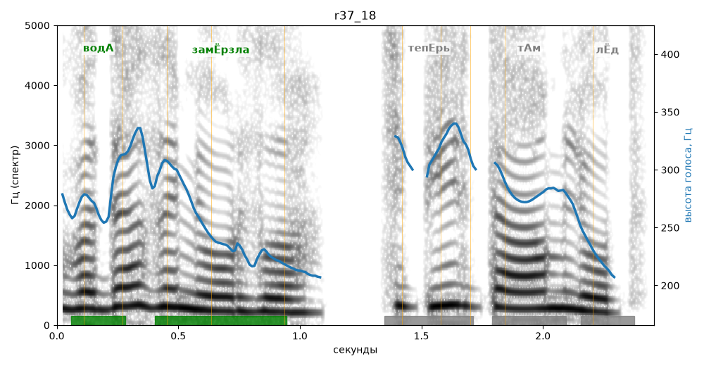

# r37_18

Голос: **Mac Milena** · длительность 2.5 с
Естественность (UTMOS): **2.48 из 5** (живой диктор ≈ 4–4.5)
Эталон: Вода замёрзла! Теперь там лёд!
Распознано: Вода замерзла. Теперь там лёд.
Слова: все совпали

## Ударения
(где нужно: ruaccent)

| слово | нужно | у голоса | |
|---|---|---|---|
| вода | водА | водА | ✓ |
| замёрзла | замЁрзла | замЁрзла | ✓ |
| теперь | тепЕрь | — | ? |

## Интонация
- ✓ «вода замёрзла!» — выделено слово «вода» (+2.6 пт)
- ✗ «теперь там лёд!» — восклицание звучит ровно, без эмоции
- Диапазон голоса 7.7 полутонов (живо), средняя высота 274 Гц

## Паузы и темп
- паузы на своих местах
- Темп 5.2 слога/с (нормально)

_Синяя линия — высота голоса. Над словами заглавная буква — где ударение должно быть; красным — голос поставил не туда (уверенно), оранжевым — возможно._
