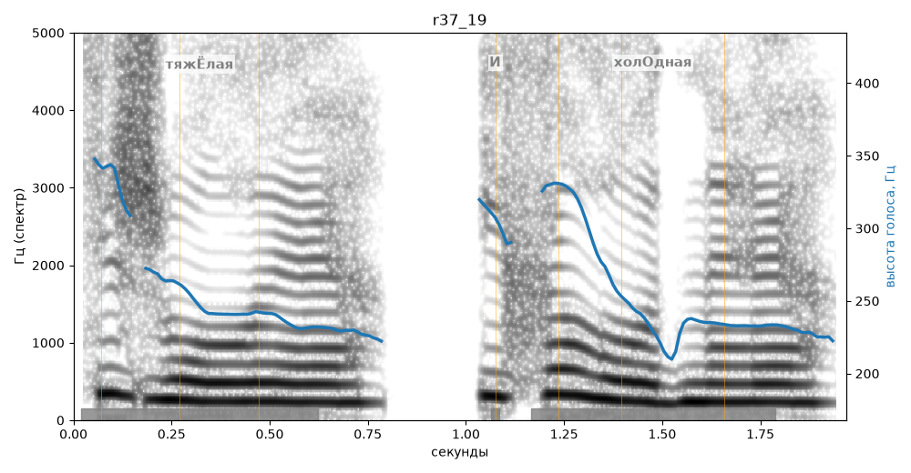

# r37_19

Голос: **Mac Milena** · длительность 2.0 с
Естественность (UTMOS): **2.52 из 5** (живой диктор ≈ 4–4.5)
Эталон: Тяжёлая. И холодная!
Распознано: тяжелые и холодные.
Расхождения в словах: «тяжелая» → «тяжелые»; «холодная» → «холодные»

## Ударения
(где нужно: ruaccent)

| слово | нужно | у голоса | |
|---|---|---|---|
| тяжёлая | тяжЁлая | — | ? |
| холодная | холОдная | — | ? |

## Интонация
- ✗ «тяжёлая.» — конец фразы не понижается — звучит незаконченно / как перечисление
- ✗ «и холодная!» — восклицание звучит ровно, без эмоции
- Диапазон голоса 6.7 полутонов (нормально), средняя высота 241 Гц

## Паузы и темп
- паузы на своих местах
- Темп 5.3 слога/с (нормально)

_Синяя линия — высота голоса. Над словами заглавная буква — где ударение должно быть; красным — голос поставил не туда (уверенно), оранжевым — возможно._
