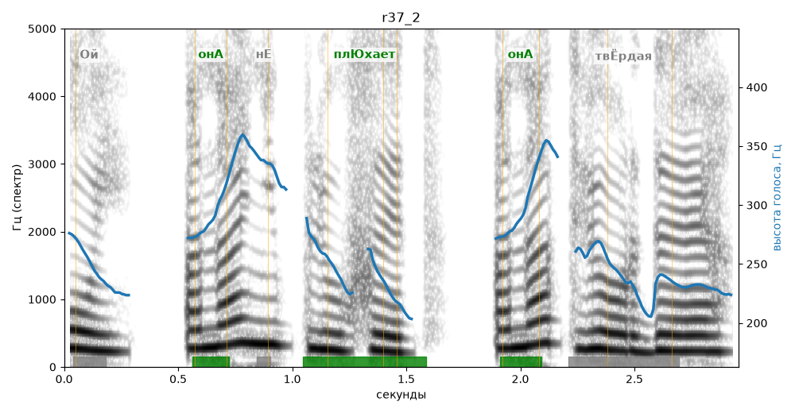

# r37_2

Голос: **Mac Milena** · длительность 3.0 с
Естественность (UTMOS): **2.5 из 5** (живой диктор ≈ 4–4.5)
Эталон: Ой! Она не плюхает! Она твёрдая!
Распознано: Ой, она не плюхает, она твердая.
Слова: все совпали

## Ударения
(где нужно: ruaccent)

| слово | нужно | у голоса | |
|---|---|---|---|
| она | онА | онА | ✓ |
| плюхает | плЮхает | плЮхает | ✓ |
| она | онА | онА | ✓ |
| твёрдая | твЁрдая | — | ? |

## Интонация
- ✓ «она не плюхает!» — выделено слово «не» (+4.1 пт)
- ✓ «она твёрдая!» — выделено слово «она» (+4.4 пт)
- Диапазон голоса 8.4 полутонов (живо), средняя высота 256 Гц

## Паузы и темп
- паузы на своих местах
- Темп 5.6 слога/с (нормально)

_Синяя линия — высота голоса. Над словами заглавная буква — где ударение должно быть; красным — голос поставил не туда (уверенно), оранжевым — возможно._
