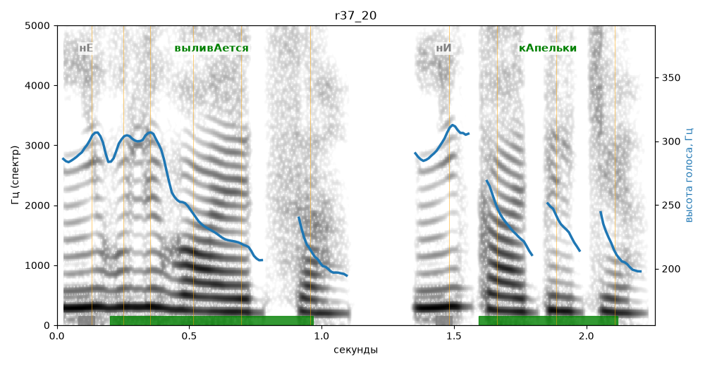

# r37_20

Голос: **Mac Milena** · длительность 2.3 с
Естественность (UTMOS): **2.55 из 5** (живой диктор ≈ 4–4.5)
Эталон: Не выливается! Ни капельки!
Распознано: не выливается, ни капельки.
Слова: все совпали

## Ударения
(где нужно: ruaccent)

| слово | нужно | у голоса | |
|---|---|---|---|
| выливается | выливАется | выливАется | ✓ |
| капельки | кАпельки | кАпельки | ✓ |

## Интонация
- ✗ «не выливается!» — восклицание звучит ровно, без эмоции
- ✓ «ни капельки!» — выделено слово «ни» (+4.4 пт)
- Диапазон голоса 7.6 полутонов (живо), средняя высота 243 Гц

## Паузы и темп
- паузы на своих местах
- Темп 6.4 слога/с (нормально)

_Синяя линия — высота голоса. Над словами заглавная буква — где ударение должно быть; красным — голос поставил не туда (уверенно), оранжевым — возможно._
