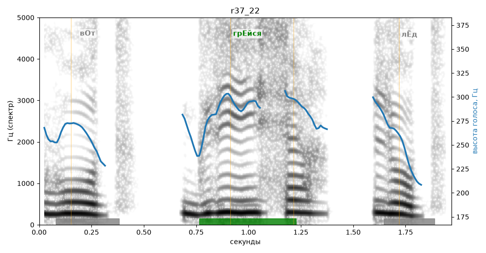

# r37_22

Голос: **Mac Milena** · длительность 2.0 с
Естественность (UTMOS): **2.76 из 5** (живой диктор ≈ 4–4.5)
Эталон: Вот. Грейся, лёд.
Распознано: Вот, грееся, лед.
Расхождения в словах: «грейся» → «грееся»

## Ударения
(где нужно: ruaccent)

| слово | нужно | у голоса | |
|---|---|---|---|
| грейся | грЕйся | грЕйся | ✓ |

## Интонация
- ✓ «грейся лёд.» — конец фразы понижается — звучит законченно
- Диапазон голоса 4.8 полутонов (нормально), средняя высота 271 Гц

## Паузы и темп
- паузы на своих местах
- Темп 4.0 слога/с (нормально)

_Синяя линия — высота голоса. Над словами заглавная буква — где ударение должно быть; красным — голос поставил не туда (уверенно), оранжевым — возможно._
