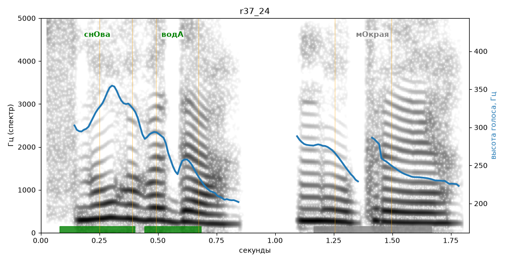

# r37_24

Голос: **Mac Milena** · длительность 1.8 с
Естественность (UTMOS): **2.65 из 5** (живой диктор ≈ 4–4.5)
Эталон: Снова вода! Мокрая!
Распознано: Снова вода мокрые.
Расхождения в словах: «мокрая» → «мокрые»

## Ударения
(где нужно: ruaccent)

| слово | нужно | у голоса | |
|---|---|---|---|
| снова | снОва | снОва | ✓ |
| вода | водА | водА | ✓ |
| мокрая | мОкрая | — | ? |

## Интонация
- ✗ «снова вода!» — восклицание звучит ровно, без эмоции
- Диапазон голоса 8.4 полутонов (живо), средняя высота 257 Гц

## Паузы и темп
- паузы на своих местах
- Темп 5.4 слога/с (нормально)

_Синяя линия — высота голоса. Над словами заглавная буква — где ударение должно быть; красным — голос поставил не туда (уверенно), оранжевым — возможно._
