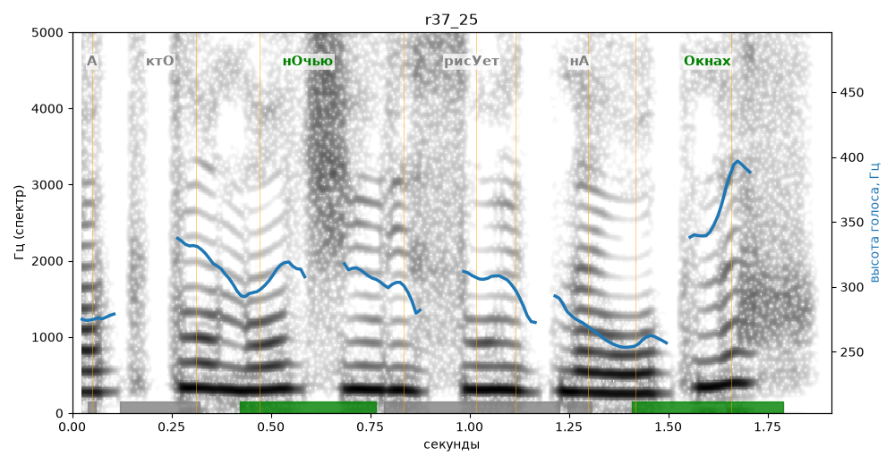

# r37_25

Голос: **Mac Milena** · длительность 1.9 с
Естественность (UTMOS): **2.21 из 5** (живой диктор ≈ 4–4.5)
Эталон: А кто ночью рисует на окнах?
Распознано: А кто ночью рисует на опнах?
Расхождения в словах: «окнах» → «опнах»

## Ударения
(где нужно: ruaccent)

| слово | нужно | у голоса | |
|---|---|---|---|
| ночью | нОчью | нОчью | ✓ |
| рисует | рисУет | рИсует | ? не разобрать |
| окнах | Окнах | Окнах | ✓ |

## Интонация
- ✗ «а кто ночью рисует на окнах?» — нет вопросительного подъёма (самое высокое место — «кто», в начале) — звучит как утверждение
- Диапазон голоса 6.5 полутонов (нормально), средняя высота 303 Гц

## Паузы и темп
- паузы на своих местах
- Темп 5.1 слога/с (нормально)

_Синяя линия — высота голоса. Над словами заглавная буква — где ударение должно быть; красным — голос поставил не туда (уверенно), оранжевым — возможно._
