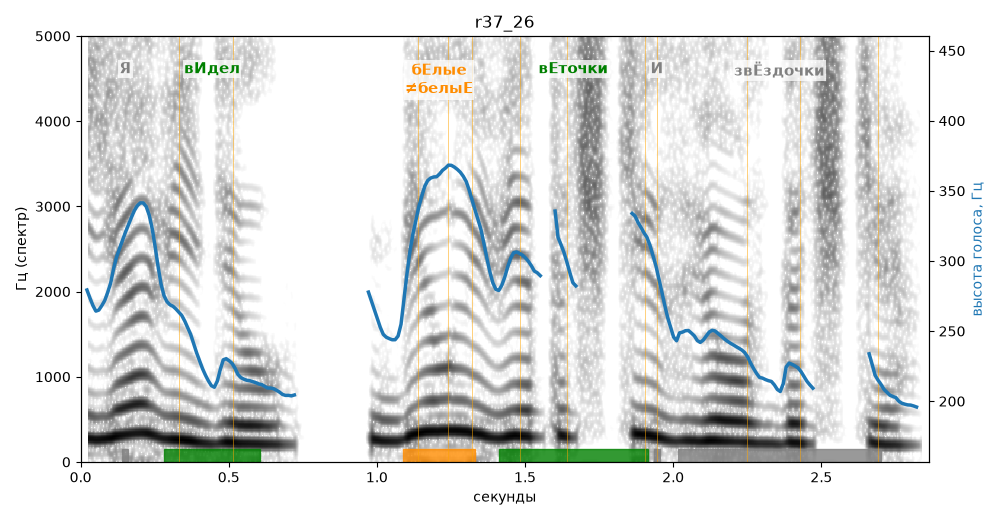

# r37_26

Голос: **Mac Milena** · длительность 2.9 с
Естественность (UTMOS): **2.67 из 5** (живой диктор ≈ 4–4.5)
Эталон: Я видел. Белые веточки и звёздочки.
Распознано: Я видел белые веточки и звездочки.
Слова: все совпали

## Ударения
(где нужно: ruaccent)

| слово | нужно | у голоса | |
|---|---|---|---|
| видел | вИдел | вИдел | ✓ |
| белые | бЕлые | белыЕ | ✗? возможно — послушать |
| веточки | вЕточки | вЕточки | ✓ |
| звёздочки | звЁздочки | звёздочкИ | ? не разобрать |

## Интонация
- ✓ «белые веточки и звёздочки.» — конец фразы понижается — звучит законченно
- Диапазон голоса 9.8 полутонов (живо), средняя высота 253 Гц

## Паузы и темп
- паузы на своих местах
- Темп 5.8 слога/с (нормально)

_Синяя линия — высота голоса. Над словами заглавная буква — где ударение должно быть; красным — голос поставил не туда (уверенно), оранжевым — возможно._
