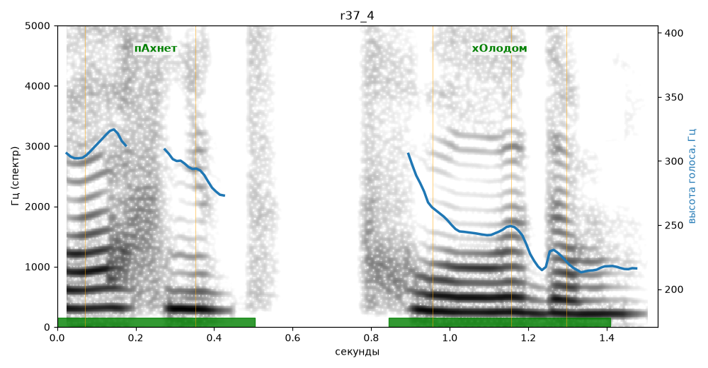

# r37_4

Голос: **Mac Milena** · длительность 1.5 с
Естественность (UTMOS): **2.66 из 5** (живой диктор ≈ 4–4.5)
Эталон: Пахнет… холодом.
Распознано: пахнет холодом.
Слова: все совпали

## Ударения
(где нужно: ruaccent)

| слово | нужно | у голоса | |
|---|---|---|---|
| пахнет | пАхнет | пАхнет | ✓ |
| холодом | хОлодом | хОлодом | ✓ |

## Интонация
- ✗ «холодом.» — конец фразы не понижается — звучит незаконченно / как перечисление
- Диапазон голоса 6.7 полутонов (нормально), средняя высота 248 Гц

## Паузы и темп
- паузы на своих местах
- Темп 4.7 слога/с (нормально)

_Синяя линия — высота голоса. Над словами заглавная буква — где ударение должно быть; красным — голос поставил не туда (уверенно), оранжевым — возможно._
