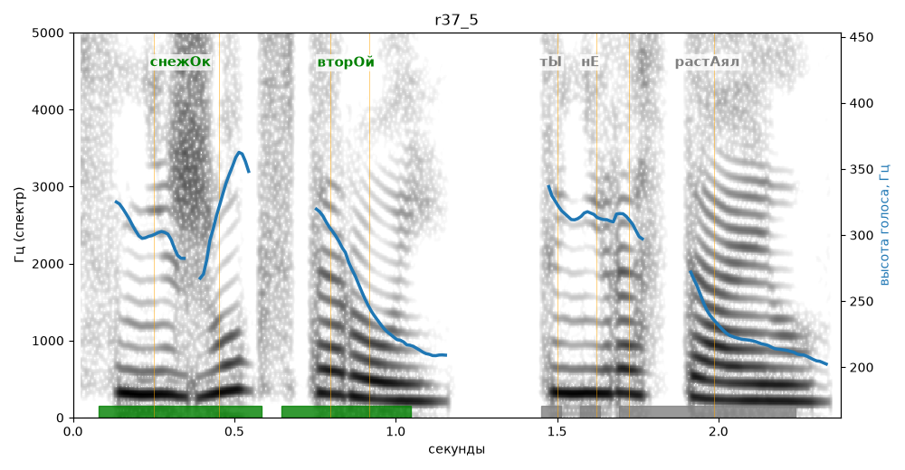

# r37_5

Голос: **Mac Milena** · длительность 2.4 с
Естественность (UTMOS): **2.52 из 5** (живой диктор ≈ 4–4.5)
Эталон: Снежок Второй! Ты не растаял!
Распознано: Снижу к второй, ты не растаял.
Расхождения в словах: «снежок» → «снижу к»

## Ударения
(где нужно: ruaccent)

| слово | нужно | у голоса | |
|---|---|---|---|
| снежок | снежОк | снежОк | ✓ |
| второй | вторОй | вторОй | ✓ |
| растаял | растАял | — | ? |

## Интонация
- ✗ «снежок второй!» — восклицание звучит ровно, без эмоции
- ✗ «ты не растаял!» — восклицание звучит ровно, без эмоции
- Диапазон голоса 8.3 полутонов (живо), средняя высота 280 Гц

## Паузы и темп
- паузы на своих местах
- Темп 4.6 слога/с (нормально)

_Синяя линия — высота голоса. Над словами заглавная буква — где ударение должно быть; красным — голос поставил не туда (уверенно), оранжевым — возможно._
