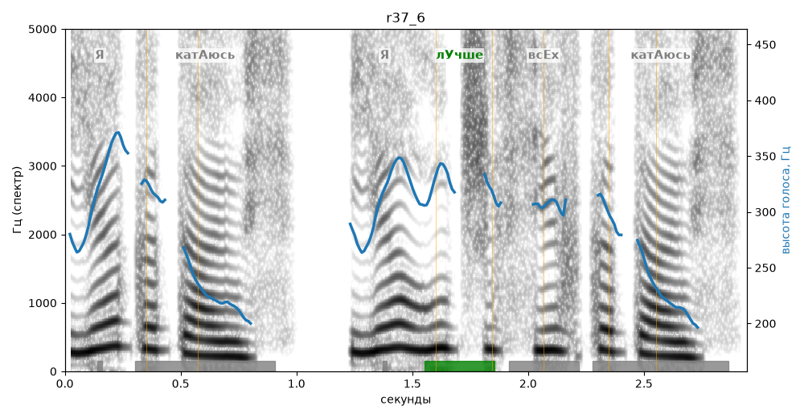

# r37_6

Голос: **Mac Milena** · длительность 2.9 с
Естественность (UTMOS): **2.83 из 5** (живой диктор ≈ 4–4.5)
Эталон: Я катаюсь! Я лучше всех катаюсь!
Распознано: Я катаюсь, я лучше всех катаюсь.
Слова: все совпали

## Ударения
(где нужно: ruaccent)

| слово | нужно | у голоса | |
|---|---|---|---|
| катаюсь | катАюсь | — | ? |
| лучше | лУчше | лУчше | ✓ |
| катаюсь | катАюсь | — | ? |

## Интонация
- ✗ «я лучше всех катаюсь!» — восклицание звучит ровно, без эмоции
- Диапазон голоса 9.0 полутонов (живо), средняя высота 300 Гц

## Паузы и темп
- паузы на своих местах
- Темп 3.3 слога/с (медленно)

_Синяя линия — высота голоса. Над словами заглавная буква — где ударение должно быть; красным — голос поставил не туда (уверенно), оранжевым — возможно._
