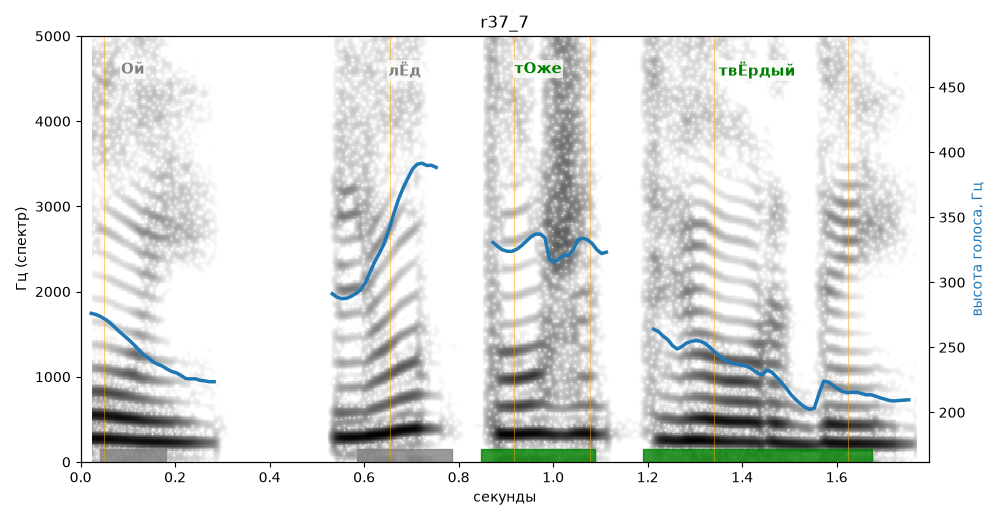

# r37_7

Голос: **Mac Milena** · длительность 1.8 с
Естественность (UTMOS): **2.04 из 5** (живой диктор ≈ 4–4.5)
Эталон: Ой. Лёд тоже твёрдый.
Распознано: Ой, Люд тоже твердый.
Расхождения в словах: «лед» → «люд»

## Ударения
(где нужно: ruaccent)

| слово | нужно | у голоса | |
|---|---|---|---|
| тоже | тОже | тОже | ✓ |
| твёрдый | твЁрдый | твЁрдый | ✓ |

## Интонация
- ✓ «лёд тоже твёрдый.» — конец фразы понижается — звучит законченно
- Диапазон голоса 10.2 полутонов (живо), средняя высота 253 Гц

## Паузы и темп
- паузы на своих местах
- Темп 4.9 слога/с (нормально)

_Синяя линия — высота голоса. Над словами заглавная буква — где ударение должно быть; красным — голос поставил не туда (уверенно), оранжевым — возможно._
