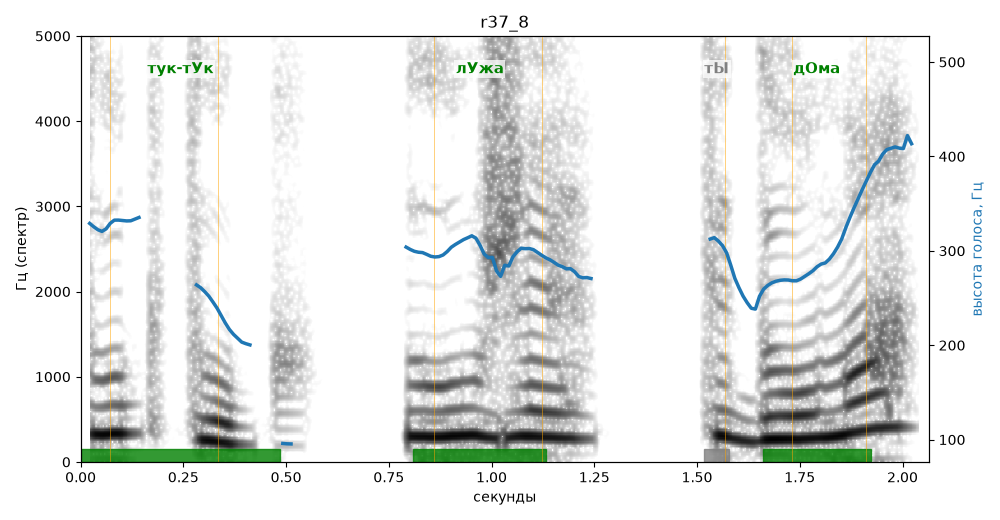

# r37_8

Голос: **Mac Milena** · длительность 2.1 с
Естественность (UTMOS): **2.32 из 5** (живой диктор ≈ 4–4.5)
Эталон: Тук-тук! Лужа, ты дома?
Распознано: Туп-туп, Лужа, ты дома?
Расхождения в словах: «тук-тук» → «туп-туп»

## Ударения
(где нужно: ruaccent)

| слово | нужно | у голоса | |
|---|---|---|---|
| тук-тук | тук-тУк | тук-тУк | ✓ |
| лужа | лУжа | лУжа | ✓ |
| дома | дОма | дОма | ✓ |

## Интонация
- ✗ «лужа ты дома?» — нет вопросительного подъёма (самое высокое место — «лужа», в начале) — звучит как утверждение
- Диапазон голоса 11.6 полутонов (живо), средняя высота 294 Гц

## Паузы и темп
- паузы на своих местах
- Темп 5.8 слога/с (нормально)

_Синяя линия — высота голоса. Над словами заглавная буква — где ударение должно быть; красным — голос поставил не туда (уверенно), оранжевым — возможно._
