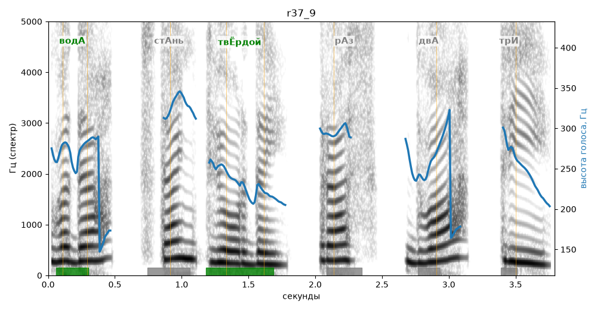

# r37_9

Голос: **Mac Milena** · длительность 3.8 с
Естественность (UTMOS): **2.54 из 5** (живой диктор ≈ 4–4.5)
Эталон: Вода, стань твёрдой! Раз, два, три!
Распознано: Вода, стань твердой. Раз, два, три.
Слова: все совпали

## Ударения
(где нужно: ruaccent)

| слово | нужно | у голоса | |
|---|---|---|---|
| вода | водА | водА | ✓ |
| твёрдой | твЁрдой | твЁрдой | ✓ |

## Интонация
- ✓ «вода стань твёрдой!» — выделено слово «стань» (+3.7 пт)
- ✗ «раз два три!» — восклицание звучит ровно, без эмоции
- Диапазон голоса 11.0 полутонов (живо), средняя высота 258 Гц

## Паузы и темп
- паузы на своих местах
- Темп 4.6 слога/с (нормально)

_Синяя линия — высота голоса. Над словами заглавная буква — где ударение должно быть; красным — голос поставил не туда (уверенно), оранжевым — возможно._
