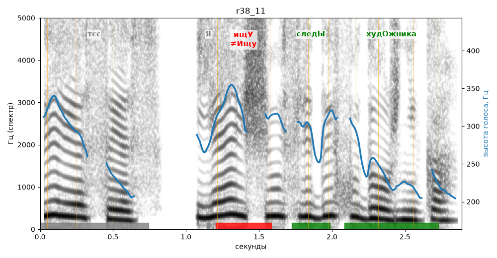

# r38_11

Голос: **Mac Milena** · длительность 2.9 с
Естественность (UTMOS): **2.68 из 5** (живой диктор ≈ 4–4.5)
Эталон: Тсс! Я ищу следы художника.
Распознано: ТСС. Я ищу следы художника.
Слова: все совпали

## Ударения
(где нужно: ruaccent)

| слово | нужно | у голоса | |
|---|---|---|---|
| ищу | ищУ | Ищу | ✗ ОШИБКА |
| следы | следЫ | следЫ | ✓ |
| художника | худОжника | худОжника | ✓ |

## Интонация
- ✓ «я ищу следы художника.» — конец фразы понижается — звучит законченно
- Диапазон голоса 8.4 полутонов (живо), средняя высота 280 Гц

## Паузы и темп
- паузы на своих местах
- Темп 4.7 слога/с (нормально)

_Синяя линия — высота голоса. Над словами заглавная буква — где ударение должно быть; красным — голос поставил не туда (уверенно), оранжевым — возможно._
