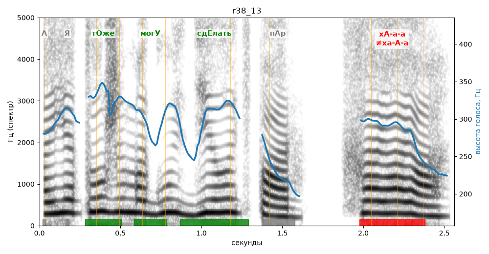

# r38_13

Голос: **Mac Milena** · длительность 2.6 с
Естественность (UTMOS): **2.25 из 5** (живой диктор ≈ 4–4.5)
Эталон: А я тоже могу сделать пар! Ха-а-а!
Распознано: А я тоже могу сделать пар, ха-а-а!
Слова: все совпали

## Ударения
(где нужно: ruaccent)

| слово | нужно | у голоса | |
|---|---|---|---|
| тоже | тОже | тОже | ✓ |
| могу | могУ | могУ | ✓ |
| сделать | сдЕлать | сдЕлать | ✓ |
| ха-а-а | хА-а-а | ха-А-а | ✗ ОШИБКА |

## Интонация
- ✗ «а я тоже могу сделать пар!» — восклицание звучит ровно, без эмоции
- ✗ «ха-а-а!» — восклицание звучит ровно, без эмоции
- Диапазон голоса 7.1 полутонов (живо), средняя высота 295 Гц

## Паузы и темп
- паузы на своих местах
- Темп 5.6 слога/с (нормально)

_Синяя линия — высота голоса. Над словами заглавная буква — где ударение должно быть; красным — голос поставил не туда (уверенно), оранжевым — возможно._
