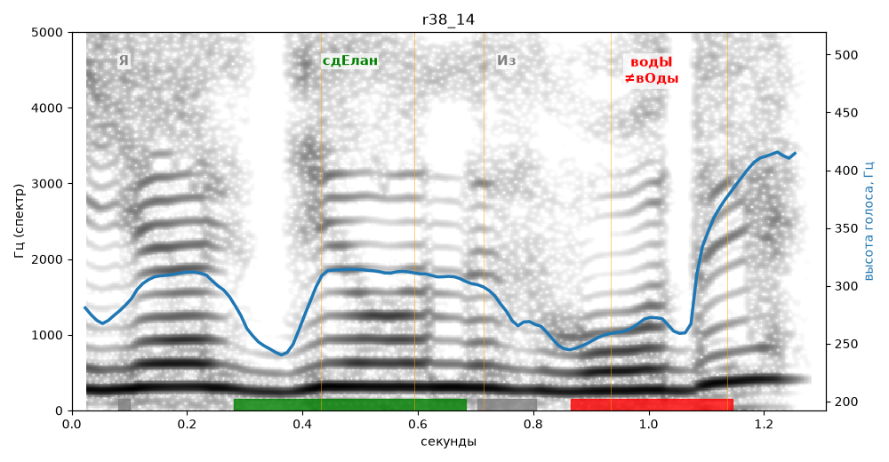

# r38_14

Голос: **Mac Milena** · длительность 1.3 с
Естественность (UTMOS): **2.62 из 5** (живой диктор ≈ 4–4.5)
Эталон: Я сделан из воды?
Распознано: Я сделана с воды?
Расхождения в словах: «сделан из» → «сделана с»

## Ударения
(где нужно: ruaccent)

| слово | нужно | у голоса | |
|---|---|---|---|
| сделан | сдЕлан | сдЕлан | ✓ |
| воды | водЫ | вОды | ✗ ОШИБКА |

## Интонация
- ✓ «я сделан из воды?» — вопросительный подъём на слове «воды»
- Диапазон голоса 8.8 полутонов (живо), средняя высота 298 Гц

## Паузы и темп
- паузы на своих местах
- Темп 5.7 слога/с (нормально)

_Синяя линия — высота голоса. Над словами заглавная буква — где ударение должно быть; красным — голос поставил не туда (уверенно), оранжевым — возможно._
