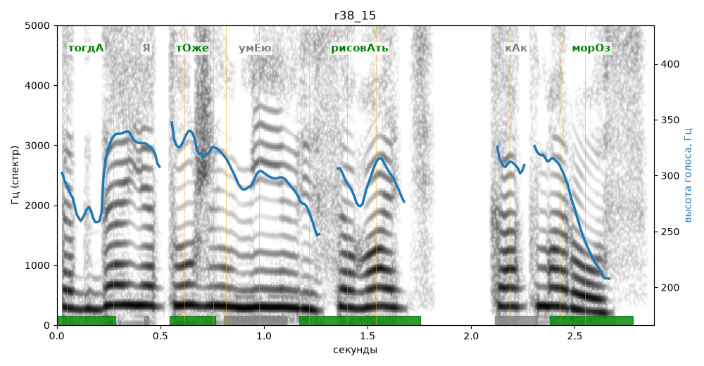

# r38_15

Голос: **Mac Milena** · длительность 2.9 с
Естественность (UTMOS): **2.55 из 5** (живой диктор ≈ 4–4.5)
Эталон: Тогда я тоже умею рисовать, как мороз!
Распознано: Тогда я тоже умею рисовать, как мороз.
Слова: все совпали

## Ударения
(где нужно: ruaccent)

| слово | нужно | у голоса | |
|---|---|---|---|
| тогда | тогдА | тогдА | ✓ |
| тоже | тОже | тОже | ✓ |
| умею | умЕю | — | ? |
| рисовать | рисовАть | рисовАть | ✓ |
| мороз | морОз | морОз | ✓ |

## Интонация
- ✗ «тогда я тоже умею рисовать как мороз!» — восклицание звучит ровно, без эмоции
- Диапазон голоса 6.3 полутонов (нормально), средняя высота 302 Гц

## Паузы и темп
- паузы на своих местах
- Темп 5.0 слога/с (нормально)

_Синяя линия — высота голоса. Над словами заглавная буква — где ударение должно быть; красным — голос поставил не туда (уверенно), оранжевым — возможно._
