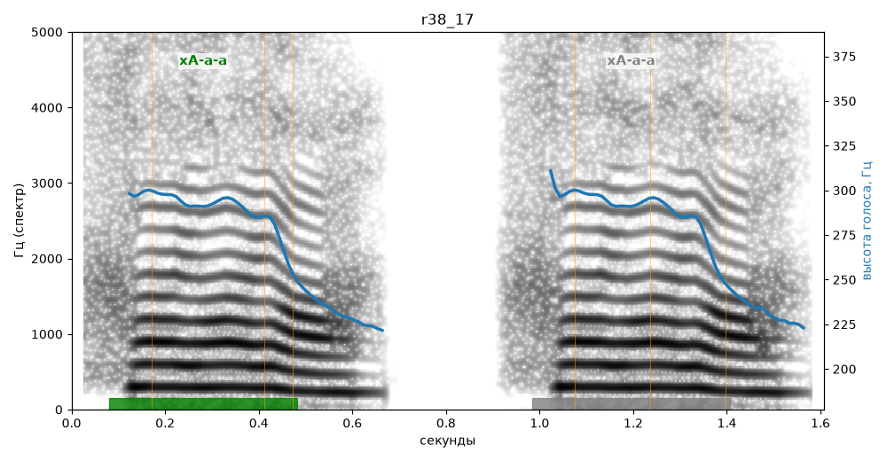

# r38_17

Голос: **Mac Milena** · длительность 1.6 с
Естественность (UTMOS): **1.43 из 5** (живой диктор ≈ 4–4.5)
Эталон: Ха-а-а! Ха-а-а!
Распознано: Хаяя! Хаяя!
Расхождения в словах: «ха-а-а ха-а-а» → «хаяя хаяя»

## Ударения
(где нужно: ruaccent)

| слово | нужно | у голоса | |
|---|---|---|---|
| ха-а-а | хА-а-а | хА-а-а | ✓ |
| ха-а-а | хА-а-а | ха-А-а | ? не разобрать |

## Интонация
- ✗ «ха-а-а!» — восклицание звучит ровно, без эмоции
- ✗ «ха-а-а!» — восклицание звучит ровно, без эмоции
- Диапазон голоса 5.0 полутонов (нормально), средняя высота 286 Гц

## Паузы и темп
- паузы на своих местах
- Темп 7.3 слога/с (быстро)

_Синяя линия — высота голоса. Над словами заглавная буква — где ударение должно быть; красным — голос поставил не туда (уверенно), оранжевым — возможно._
