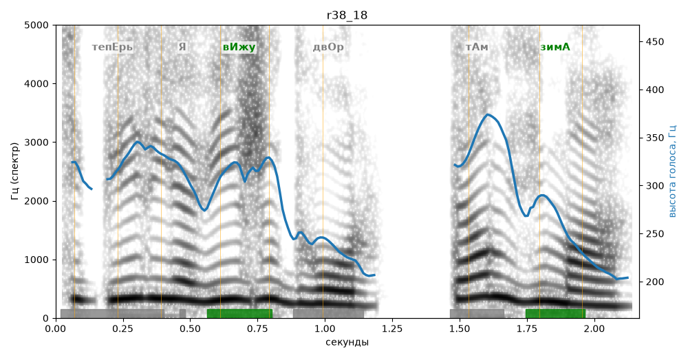

# r38_18

Голос: **Mac Milena** · длительность 2.2 с
Естественность (UTMOS): **3.02 из 5** (живой диктор ≈ 4–4.5)
Эталон: Теперь я вижу двор. Там зима.
Распознано: Теперь я вижу двор. Там зима.
Слова: все совпали

## Ударения
(где нужно: ruaccent)

| слово | нужно | у голоса | |
|---|---|---|---|
| теперь | тепЕрь | — | ? |
| вижу | вИжу | вИжу | ✓ |
| зима | зимА | зимА | ✓ |

## Интонация
- ✓ «теперь я вижу двор.» — конец фразы понижается — звучит законченно
- ✓ «там зима.» — конец фразы понижается — звучит законченно
- Диапазон голоса 9.4 полутонов (живо), средняя высота 296 Гц

## Паузы и темп
- паузы на своих местах
- Темп 5.5 слога/с (нормально)

_Синяя линия — высота голоса. Над словами заглавная буква — где ударение должно быть; красным — голос поставил не туда (уверенно), оранжевым — возможно._
