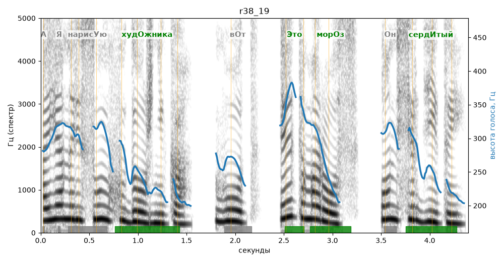

# r38_19

Голос: **Mac Milena** · длительность 4.4 с
Естественность (UTMOS): **2.54 из 5** (живой диктор ≈ 4–4.5)
Эталон: А я нарисую художника. Вот. Это Мороз. Он сердитый.
Распознано: А я нарисую художника. Вот, это Мороз, он сердитый.
Слова: все совпали

## Ударения
(где нужно: ruaccent)

| слово | нужно | у голоса | |
|---|---|---|---|
| нарисую | нарисУю | — | ? |
| художника | худОжника | худОжника | ✓ |
| это | Это | Это | ✓ |
| мороз | морОз | морОз | ✓ |
| сердитый | сердИтый | сердИтый | ✓ |

## Интонация
- ✓ «а я нарисую художника.» — конец фразы понижается — звучит законченно
- ✓ «это мороз.» — конец фразы понижается — звучит законченно
- ✓ «он сердитый.» — конец фразы понижается — звучит законченно
- Диапазон голоса 8.8 полутонов (живо), средняя высота 270 Гц

## Паузы и темп
- паузы на своих местах
- Темп 5.5 слога/с (нормально)

_Синяя линия — высота голоса. Над словами заглавная буква — где ударение должно быть; красным — голос поставил не туда (уверенно), оранжевым — возможно._
