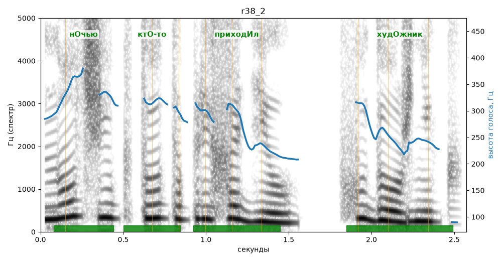

# r38_2

Голос: **Mac Milena** · длительность 2.6 с
Естественность (UTMOS): **2.52 из 5** (живой диктор ≈ 4–4.5)
Эталон: Ночью кто-то приходил! Художник!
Распознано: Ночью кто-то приходил, художник.
Слова: все совпали

## Ударения
(где нужно: ruaccent)

| слово | нужно | у голоса | |
|---|---|---|---|
| ночью | нОчью | нОчью | ✓ |
| кто-то | ктО-то | ктО-то | ✓ |
| приходил | приходИл | приходИл | ✓ |
| художник | худОжник | худОжник | ✓ |

## Интонация
- ✓ «ночью кто-то приходил!» — выделено слово «ночью» (+2.1 пт)
- ✗ «художник!» — восклицание звучит ровно, без эмоции
- Диапазон голоса 8.6 полутонов (живо), средняя высота 281 Гц

## Паузы и темп
- паузы на своих местах
- Темп 4.5 слога/с (нормально)

_Синяя линия — высота голоса. Над словами заглавная буква — где ударение должно быть; красным — голос поставил не туда (уверенно), оранжевым — возможно._
