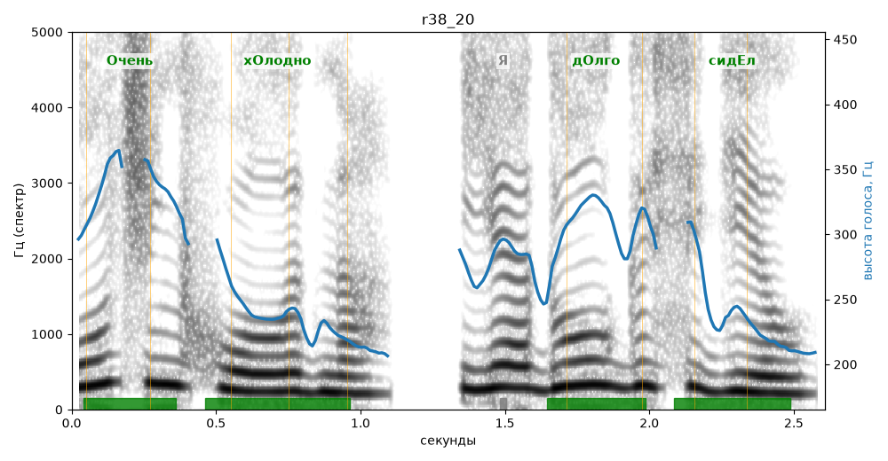

# r38_20

Голос: **Mac Milena** · длительность 2.6 с
Естественность (UTMOS): **2.87 из 5** (живой диктор ≈ 4–4.5)
Эталон: Очень холодно! Я долго сидел.
Распознано: Очень холодно, я долго сидел.
Слова: все совпали

## Ударения
(где нужно: ruaccent)

| слово | нужно | у голоса | |
|---|---|---|---|
| очень | Очень | Очень | ✓ |
| холодно | хОлодно | хОлодно | ✓ |
| долго | дОлго | дОлго | ✓ |
| сидел | сидЕл | сидЕл | ✓ |

## Интонация
- ✓ «очень холодно!» — выделено слово «очень» (+4.5 пт)
- ✓ «я долго сидел.» — конец фразы понижается — звучит законченно
- Диапазон голоса 8.6 полутонов (живо), средняя высота 264 Гц

## Паузы и темп
- паузы на своих местах
- Темп 4.7 слога/с (нормально)

_Синяя линия — высота голоса. Над словами заглавная буква — где ударение должно быть; красным — голос поставил не туда (уверенно), оранжевым — возможно._
