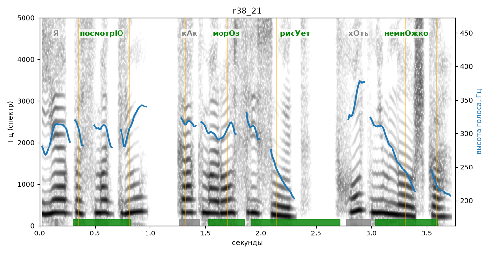

# r38_21

Голос: **Mac Milena** · длительность 3.8 с
Естественность (UTMOS): **2.62 из 5** (живой диктор ≈ 4–4.5)
Эталон: Я посмотрю, как мороз рисует. Хоть немножко.
Распознано: Я посмотрю, как мороз рисует, хоть немножко.
Слова: все совпали

## Ударения
(где нужно: ruaccent)

| слово | нужно | у голоса | |
|---|---|---|---|
| посмотрю | посмотрЮ | посмотрЮ | ✓ |
| мороз | морОз | морОз | ✓ |
| рисует | рисУет | рисУет | ✓ |
| немножко | немнОжко | немнОжко | ✓ |

## Интонация
- ✓ «я посмотрю как мороз рисует.» — конец фразы понижается — звучит законченно
- ✓ «хоть немножко.» — конец фразы понижается — звучит законченно
- Диапазон голоса 8.1 полутонов (живо), средняя высота 301 Гц

## Паузы и темп
- после «рисует.» пауза всего 0.06 с — фразы слипаются
- Темп 4.3 слога/с (нормально)

_Синяя линия — высота голоса. Над словами заглавная буква — где ударение должно быть; красным — голос поставил не туда (уверенно), оранжевым — возможно._
