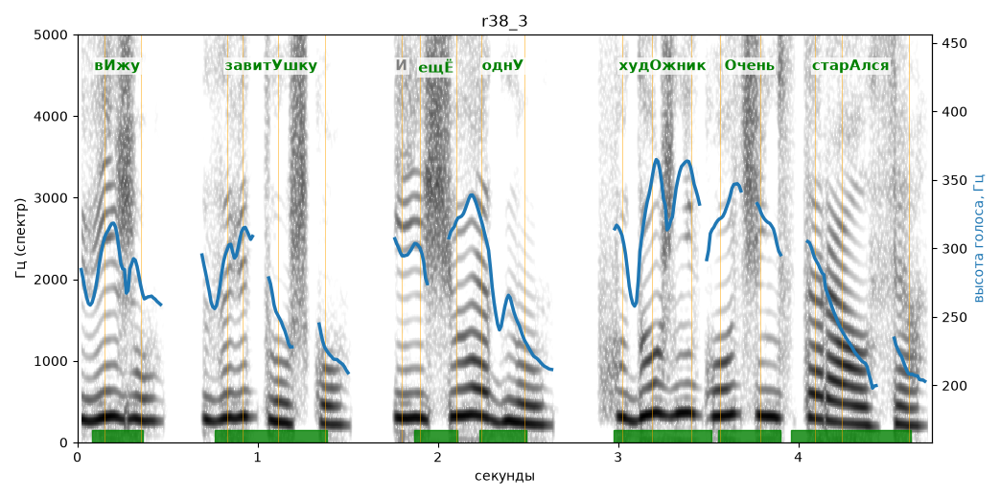

# r38_3

Голос: **Mac Milena** · длительность 4.7 с
Естественность (UTMOS): **2.52 из 5** (живой диктор ≈ 4–4.5)
Эталон: Вижу… завитушку. И ещё одну. Художник очень старался.
Распознано: вижу, завитушку, и еще одну, художник очень старался.
Слова: все совпали

## Ударения
(где нужно: ruaccent)

| слово | нужно | у голоса | |
|---|---|---|---|
| вижу | вИжу | вИжу | ✓ |
| завитушку | завитУшку | завитУшку | ✓ |
| ещё | ещЁ | ещЁ | ✓ |
| одну | однУ | однУ | ✓ |
| художник | худОжник | худОжник | ✓ |
| очень | Очень | Очень | ✓ |
| старался | старАлся | старАлся | ✓ |

## Интонация
- ✓ «завитушку.» — конец фразы понижается — звучит законченно
- ✓ «и ещё одну.» — конец фразы понижается — звучит законченно
- ✓ «художник очень старался.» — конец фразы понижается — звучит законченно
- Диапазон голоса 8.6 полутонов (живо), средняя высота 285 Гц

## Паузы и темп
- паузы на своих местах
- Темп 5.8 слога/с (нормально)

_Синяя линия — высота голоса. Над словами заглавная буква — где ударение должно быть; красным — голос поставил не туда (уверенно), оранжевым — возможно._
