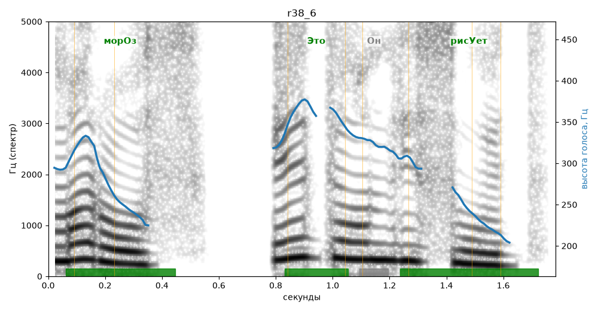

# r38_6

Голос: **Mac Milena** · длительность 1.8 с
Естественность (UTMOS): **2.66 из 5** (живой диктор ≈ 4–4.5)
Эталон: Мороз! Это он рисует!
Распознано: Мороз, это он лисует.
Расхождения в словах: «рисует» → «лисует»

## Ударения
(где нужно: ruaccent)

| слово | нужно | у голоса | |
|---|---|---|---|
| мороз | морОз | морОз | ✓ |
| это | Это | Это | ✓ |
| рисует | рисУет | рисУет | ✓ |

## Интонация
- ✓ «это он рисует!» — выделено слово «это» (+2.2 пт)
- Диапазон голоса 9.1 полутонов (живо), средняя высота 306 Гц

## Паузы и темп
- паузы на своих местах
- Темп 6.3 слога/с (нормально)

_Синяя линия — высота голоса. Над словами заглавная буква — где ударение должно быть; красным — голос поставил не туда (уверенно), оранжевым — возможно._
