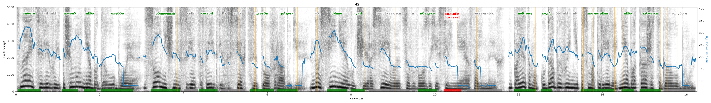

# r42

Голос: **silero_random:42** · длительность 16.3 с
Естественность (UTMOS): **1.62 из 5** (живой диктор ≈ 4–4.5)
Эталон: Знаете ли вы, почему небо голубое? Солнечный свет состоит из всех цветов радуги. Но синие лучи рассеиваются в воздухе сильнее остальных. Поэтому, куда бы вы ни посмотрели, небо кажется голубым.
Распознано: Знаете ли вы, почему небо голубое? Солнечный свет состоит из всех цветов радуги, но синие лучи рассеиваются в воздухе сильнее остальных. Поэтому, куда бы вы ни посмотрели, небо кажется голубым.
Слова: все совпали

## Ударения
(где нужно: ruaccent)

| слово | нужно | у голоса | |
|---|---|---|---|
| знаете | знАете | знАете | ✓ |
| почему | почемУ | почемУ | ✓ |
| небо | нЕбо | нЕбо | ✓ |
| голубое | голубОе | голубОе | ✓ |
| солнечный | сОлнечный | сОлнечный | ✓ |
| состоит | состоИт | состоИт | ✓ |
| цветов | цветОв | цветОв | ✓ |
| радуги | рАдуги | рАдуги | ✓ |
| синие | сИние | сИние | ✓ |
| лучи | лучИ | лучИ | ✓ |
| рассеиваются | рассЕиваются | — | ? |
| воздухе | вОздухе | вОздухе | ✓ |
| сильнее | сильнЕе | сильнеЕ | ✗ ОШИБКА |
| остальных | остальнЫх | остАльных | ? не разобрать |
| поэтому | поЭтому | поЭтому | ✓ |
| куда | кудА | кудА | ✓ |
| посмотрели | посмотрЕли | посмотрЕли | ✓ |
| небо | нЕбо | нЕбо | ✓ |
| кажется | кАжется | кАжется | ✓ |
| голубым | голубЫм | гОлубым | ? не разобрать |

## Интонация
- ✓ «знаете ли вы почему небо голубое?» — вопросительный подъём на слове «знаете»
- ✓ «солнечный свет состоит из всех цветов радуги.» — конец фразы понижается — звучит законченно
- ✓ «но синие лучи рассеиваются в воздухе сильнее остальных.» — конец фразы понижается — звучит законченно
- ✓ «поэтому куда бы вы ни посмотрели небо кажется голубым.» — конец фразы понижается — звучит законченно
- Диапазон голоса 21.7 полутонов (живо), средняя высота 198 Гц

## Паузы и темп
- паузы на своих местах
- Темп 5.0 слога/с (нормально)

_Синяя линия — высота голоса. Над словами заглавная буква — где ударение должно быть; красным — голос поставил не туда (уверенно), оранжевым — возможно._
