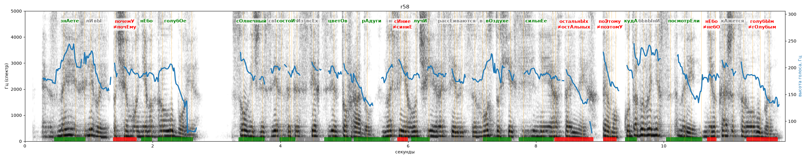

# r58

Голос: **silero_random:58** · длительность 11.9 с
Естественность (UTMOS): **1.41 из 5** (живой диктор ≈ 4–4.5)
Эталон: Знаете ли вы, почему небо голубое? Солнечный свет состоит из всех цветов радуги. Но синие лучи рассеиваются в воздухе сильнее остальных. Поэтому, куда бы вы ни посмотрели, небо кажется голубым.
Распознано: Знаете ли вы, почему не мог голубое? Солнечный свет сет из всех цветов раду, но сия лучшие рассеивятся в воздухе сезиней и остальных. Тему, куда бы вы ни с мрей не окажется голубым.
Расхождения в словах: «небо» → «не мог»; «состоит» → «сет»; «радуги» → «раду»; «синие лучи рассеиваются» → «сия лучшие рассеивятся»; «сильнее» → «сезиней и»; «поэтому» → «тему»; «посмотрели небо кажется» → «с мрей не окажется»

## Ударения
(где нужно: ruaccent)

| слово | нужно | у голоса | |
|---|---|---|---|
| знаете | знАете | знАете | ✓ |
| почему | почемУ | почЕму | ✗ ОШИБКА |
| небо | нЕбо | нЕбо | ✓ |
| голубое | голубОе | голубОе | ✓ |
| солнечный | сОлнечный | сОлнечный | ✓ |
| состоит | состоИт | состоИт | ✓ |
| цветов | цветОв | цветОв | ✓ |
| радуги | рАдуги | рАдуги | ✓ |
| синие | сИние | синиЕ | ✗ ОШИБКА |
| лучи | лучИ | лучИ | ✓ |
| рассеиваются | рассЕиваются | — | ? |
| воздухе | вОздухе | вОздухе | ✓ |
| сильнее | сильнЕе | сильнЕе | ✓ |
| остальных | остальнЫх | остАльных | ✗ ОШИБКА |
| поэтому | поЭтому | поэтомУ | ✗ ОШИБКА |
| куда | кудА | кудА | ✓ |
| посмотрели | посмотрЕли | посмотрЕли | ✓ |
| небо | нЕбо | небО | ✗ ОШИБКА |
| кажется | кАжется | кажетсЯ | ? не разобрать |
| голубым | голубЫм | гОлубым | ✗ ОШИБКА |

## Интонация
- ✓ «знаете ли вы почему небо голубое?» — вопросительный подъём на слове «знаете»
- ✓ «солнечный свет состоит из всех цветов радуги.» — конец фразы понижается — звучит законченно
- ✓ «но синие лучи рассеиваются в воздухе сильнее остальных.» — конец фразы понижается — звучит законченно
- ✓ «поэтому куда бы вы ни посмотрели небо кажется голубым.» — конец фразы понижается — звучит законченно
- Диапазон голоса 8.9 полутонов (живо), средняя высота 188 Гц

## Паузы и темп
- после «радуги.» пауза всего 0.02 с — фразы слипаются
- после «остальных.» пауза всего 0.16 с — фразы слипаются
- Темп 6.8 слога/с (быстро)

_Синяя линия — высота голоса. Над словами заглавная буква — где ударение должно быть; красным — голос поставил не туда (уверенно), оранжевым — возможно._
