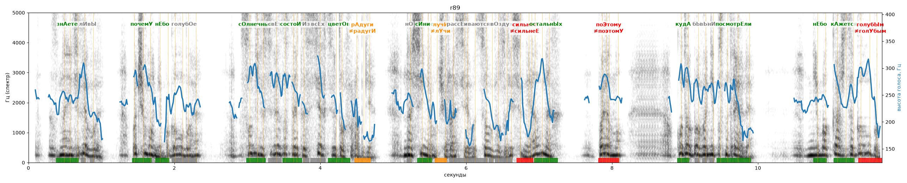

# r89

Голос: **silero_random:89** · длительность 11.7 с
Естественность (UTMOS): **1.28 из 5** (живой диктор ≈ 4–4.5)
Эталон: Знаете ли вы, почему небо голубое? Солнечный свет состоит из всех цветов радуги. Но синие лучи рассеиваются в воздухе сильнее остальных. Поэтому, куда бы вы ни посмотрели, небо кажется голубым.
Распознано: Знаете, левые, почему они по голубам? Солнечный свет застает из всех цветов в радге. Насинял чараси, в целую заисель, и я в них пойму. Куда бы они посмотрели? Небо каждый за голубом.
Расхождения в словах: «ли вы» → «левые»; «небо голубое» → «они по голубам»; «состоит» → «застает»; «радуги но синие лучи рассеиваются» → «»; «воздухе сильнее остальных поэтому» → «радге насинял чараси в целую заисель и я в них пойму»; «вы ни» → «они»; «кажется голубым» → «каждый за голубом»

## Ударения
(где нужно: ruaccent)

| слово | нужно | у голоса | |
|---|---|---|---|
| знаете | знАете | знАете | ✓ |
| почему | почемУ | почемУ | ✓ |
| небо | нЕбо | нЕбо | ✓ |
| голубое | голубОе | голубоЕ | ? не разобрать |
| солнечный | сОлнечный | сОлнечный | ✓ |
| состоит | состоИт | состоИт | ✓ |
| цветов | цветОв | цветОв | ✓ |
| радуги | рАдуги | радугИ | ✗? возможно — послушать |
| синие | сИние | сИние | ✓ |
| лучи | лучИ | лУчи | ✗? возможно — послушать |
| рассеиваются | рассЕиваются | — | ? |
| воздухе | вОздухе | воздухЕ | ? не разобрать |
| сильнее | сильнЕе | сильнеЕ | ✗ ОШИБКА |
| остальных | остальнЫх | остальнЫх | ✓ |
| поэтому | поЭтому | поэтомУ | ✗ ОШИБКА |
| куда | кудА | кудА | ✓ |
| посмотрели | посмотрЕли | посмотрЕли | ✓ |
| небо | нЕбо | нЕбо | ✓ |
| кажется | кАжется | кАжется | ✓ |
| голубым | голубЫм | голУбым | ✗ ОШИБКА |

## Интонация
- ✗ «знаете ли вы почему небо голубое?» — нет вопросительного подъёма (самое высокое место — «ли», в начале) — звучит как утверждение
- ✓ «солнечный свет состоит из всех цветов радуги.» — конец фразы понижается — звучит законченно
- ✗ «но синие лучи рассеиваются в воздухе сильнее остальных.» — конец фразы не понижается — звучит незаконченно / как перечисление
- ✓ «поэтому куда бы вы ни посмотрели небо кажется голубым.» — конец фразы понижается — звучит законченно
- Диапазон голоса 8.9 полутонов (живо), средняя высота 241 Гц

## Паузы и темп
- паузы на своих местах
- Темп 9.5 слога/с (быстро)

_Синяя линия — высота голоса. Над словами заглавная буква — где ударение должно быть; красным — голос поставил не туда (уверенно), оранжевым — возможно._
