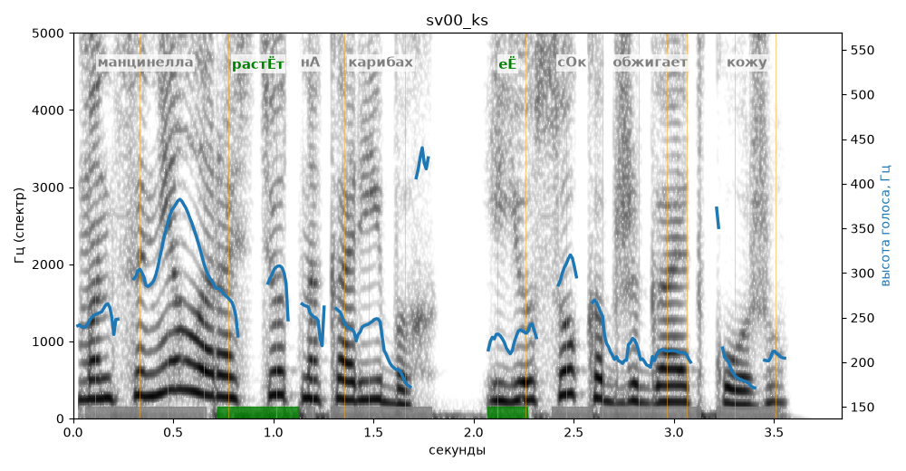

# sv00_ks

Голос: **silero:kseniya** · длительность 3.8 с
Естественность (UTMOS): **3.25 из 5** (живой диктор ≈ 4–4.5)
Эталон: Манцинелла растёт на Карибах, её сок обжигает кожу.
Распознано: Монценела растет на карибах, ее сок обжигает кожу.
Расхождения в словах: «манцинелла» → «монценела»

## Ударения
(где нужно: нет)

| слово | нужно | у голоса | |
|---|---|---|---|
| манцинелла | манцинелла | манцинЕлла | нет эталона |
| растёт | растЁт | растЁт | ✓ |
| карибах | карибах | карИбах | нет эталона |
| её | еЁ | еЁ | ✓ |
| обжигает | обжигает | обжигАет | нет эталона |
| кожу | кожу | кОжу | нет эталона |

## Интонация
- ✓ «манцинелла растёт на карибах её сок обжигает кожу.» — конец фразы понижается — звучит законченно
- Диапазон голоса 12.4 полутонов (живо), средняя высота 242 Гц

## Паузы и темп
- паузы на своих местах
- Темп 6.0 слога/с (нормально)

_Синяя линия — высота голоса. Над словами заглавная буква — где ударение должно быть; красным — голос поставил не туда (уверенно), оранжевым — возможно._
