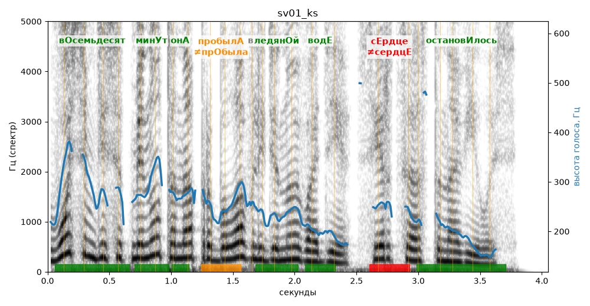

# sv01_ks

Голос: **silero:kseniya** · длительность 4.0 с
Естественность (UTMOS): **3.68 из 5** (живой диктор ≈ 4–4.5)
Эталон: Восемьдесят минут она пробыла в ледяной воде, сердце остановилось.
Распознано: Восемьдесят минут она пробыла в ледяной воде, сердце остановилось.
Слова: все совпали

## Ударения
(где нужно: ruaccent)

| слово | нужно | у голоса | |
|---|---|---|---|
| восемьдесят | вОсемьдесят | вОсемьдесят | ✓ |
| минут | минУт | минУт | ✓ |
| она | онА | онА | ✓ |
| пробыла | пробылА | прОбыла | ✗? возможно — послушать |
| ледяной | ледянОй | ледянОй | ✓ |
| воде | водЕ | водЕ | ✓ |
| сердце | сЕрдце | сердцЕ | ✗ ОШИБКА |
| остановилось | остановИлось | остановИлось | ✓ |

## Интонация
- ✓ «восемьдесят минут она пробыла в ледяной воде сердце остановилось.» — конец фразы понижается — звучит законченно
- Диапазон голоса 13.1 полутонов (живо), средняя высота 244 Гц

## Паузы и темп
- паузы на своих местах
- Темп 7.1 слога/с (быстро)

_Синяя линия — высота голоса. Над словами заглавная буква — где ударение должно быть; красным — голос поставил не туда (уверенно), оранжевым — возможно._
