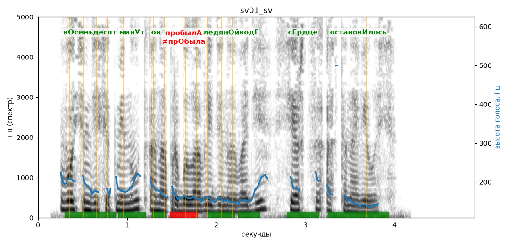

# sv01_sv

Голос: **edge:ru-RU-SvetlanaNeural** · длительность 4.9 с
Естественность (UTMOS): **3.72 из 5** (живой диктор ≈ 4–4.5)
Эталон: Восемьдесят минут она пробыла в ледяной воде, сердце остановилось.
Распознано: 80 минут она пробыла в ледяной воде, сердце остановилось.
Расхождения в словах: «восемьдесят» → «80»

## Ударения
(где нужно: ruaccent)

| слово | нужно | у голоса | |
|---|---|---|---|
| восемьдесят | вОсемьдесят | вОсемьдесят | ✓ |
| минут | минУт | минУт | ✓ |
| она | онА | онА | ✓ |
| пробыла | пробылА | прОбыла | ✗ ОШИБКА |
| ледяной | ледянОй | ледянОй | ✓ |
| воде | водЕ | водЕ | ✓ |
| сердце | сЕрдце | сЕрдце | ✓ |
| остановилось | остановИлось | остановИлось | ✓ |

## Интонация
- ✓ «восемьдесят минут она пробыла в ледяной воде сердце остановилось.» — конец фразы понижается — звучит законченно
- Диапазон голоса 7.5 полутонов (живо), средняя высота 166 Гц

## Паузы и темп
- паузы на своих местах
- Темп 7.2 слога/с (быстро)

_Синяя линия — высота голоса. Над словами заглавная буква — где ударение должно быть; красным — голос поставил не туда (уверенно), оранжевым — возможно._
