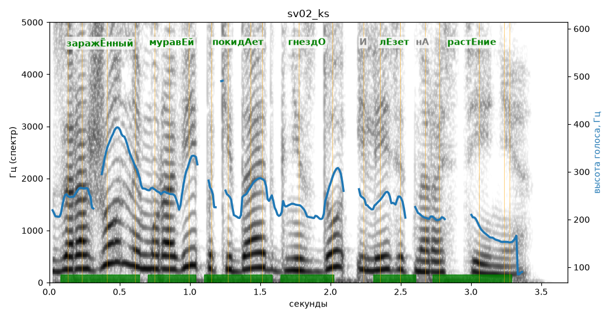

# sv02_ks

Голос: **silero:kseniya** · длительность 3.7 с
Естественность (UTMOS): **3.24 из 5** (живой диктор ≈ 4–4.5)
Эталон: Заражённый муравей покидает гнездо и лезет на растение.
Распознано: Заражённый муравей покидает гнездо и лезет на растение.
Слова: все совпали

## Ударения
(где нужно: ruaccent)

| слово | нужно | у голоса | |
|---|---|---|---|
| заражённый | заражЁнный | заражЁнный | ✓ |
| муравей | муравЕй | муравЕй | ✓ |
| покидает | покидАет | покидАет | ✓ |
| гнездо | гнездО | гнездО | ✓ |
| лезет | лЕзет | лЕзет | ✓ |
| растение | растЕние | растЕние | ✓ |

## Интонация
- ✓ «заражённый муравей покидает гнездо и лезет на растение.» — конец фразы понижается — звучит законченно
- Диапазон голоса 14.5 полутонов (живо), средняя высота 243 Гц

## Паузы и темп
- паузы на своих местах
- Темп 7.0 слога/с (быстро)

_Синяя линия — высота голоса. Над словами заглавная буква — где ударение должно быть; красным — голос поставил не туда (уверенно), оранжевым — возможно._
