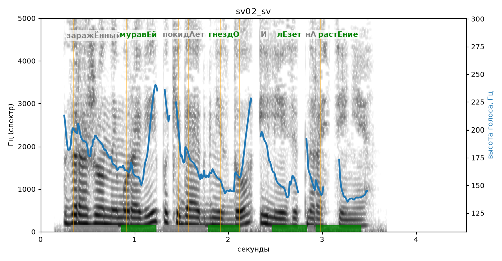

# sv02_sv

Голос: **edge:ru-RU-SvetlanaNeural** · длительность 4.5 с
Естественность (UTMOS): **3.59 из 5** (живой диктор ≈ 4–4.5)
Эталон: Заражённый муравей покидает гнездо и лезет на растение.
Распознано: Зараженный муравей покидает гнездо и лезет на растение.
Слова: все совпали

## Ударения
(где нужно: ruaccent)

| слово | нужно | у голоса | |
|---|---|---|---|
| заражённый | заражЁнный | зарАжённый | ? не разобрать |
| муравей | муравЕй | муравЕй | ✓ |
| покидает | покидАет | пОкидает | ? не разобрать |
| гнездо | гнездО | гнездО | ✓ |
| лезет | лЕзет | лЕзет | ✓ |
| растение | растЕние | растЕние | ✓ |

## Интонация
- ✓ «заражённый муравей покидает гнездо и лезет на растение.» — конец фразы понижается — звучит законченно
- Диапазон голоса 7.6 полутонов (живо), средняя высота 164 Гц

## Паузы и темп
- паузы на своих местах
- Темп 7.4 слога/с (быстро)

_Синяя линия — высота голоса. Над словами заглавная буква — где ударение должно быть; красным — голос поставил не туда (уверенно), оранжевым — возможно._
