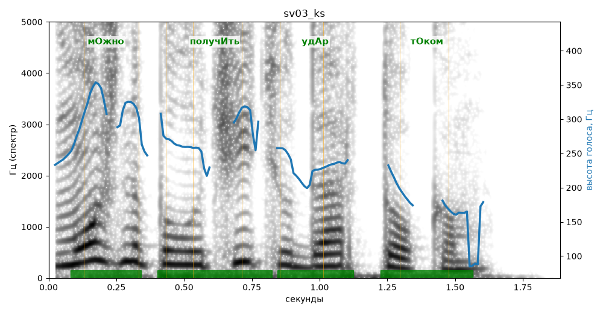

# sv03_ks

Голос: **silero:kseniya** · длительность 1.9 с
Естественность (UTMOS): **3.49 из 5** (живой диктор ≈ 4–4.5)
Эталон: Можно получить удар током.
Распознано: Можно получить удар током.
Слова: все совпали

## Ударения
(где нужно: ruaccent)

| слово | нужно | у голоса | |
|---|---|---|---|
| можно | мОжно | мОжно | ✓ |
| получить | получИть | получИть | ✓ |
| удар | удАр | удАр | ✓ |
| током | тОком | тОком | ✓ |

## Интонация
- ✓ «можно получить удар током.» — конец фразы понижается — звучит законченно
- Диапазон голоса 12.1 полутонов (живо), средняя высота 248 Гц

## Паузы и темп
- паузы на своих местах
- Темп 6.1 слога/с (нормально)

_Синяя линия — высота голоса. Над словами заглавная буква — где ударение должно быть; красным — голос поставил не туда (уверенно), оранжевым — возможно._
