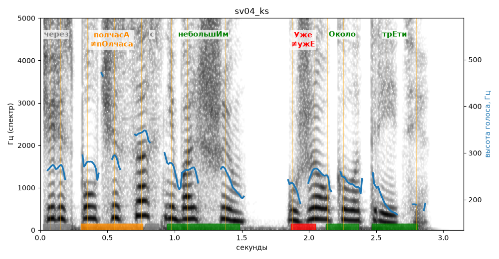

# sv04_ks

Голос: **silero:kseniya** · длительность 3.1 с
Естественность (UTMOS): **3.48 из 5** (живой диктор ≈ 4–4.5)
Эталон: Через полчаса с небольшим — уже около трети.
Распознано: Через полчаса с небольшим уже около трети.
Слова: все совпали

## Ударения
(где нужно: ruaccent)

| слово | нужно | у голоса | |
|---|---|---|---|
| через | через | чЕрез | нет эталона |
| полчаса | полчасА | пОлчаса | ✗? возможно — послушать |
| небольшим | небольшИм | небольшИм | ✓ |
| уже | Уже | ужЕ | ✗ ОШИБКА |
| около | Около | Около | ✓ |
| трети | трЕти | трЕти | ✓ |

## Интонация
- ✓ «через полчаса с небольшим уже около трети.» — конец фразы понижается — звучит законченно
- Диапазон голоса 10.7 полутонов (живо), средняя высота 255 Гц

## Паузы и темп
- паузы на своих местах
- Темп 6.6 слога/с (быстро)

_Синяя линия — высота голоса. Над словами заглавная буква — где ударение должно быть; красным — голос поставил не туда (уверенно), оранжевым — возможно._
