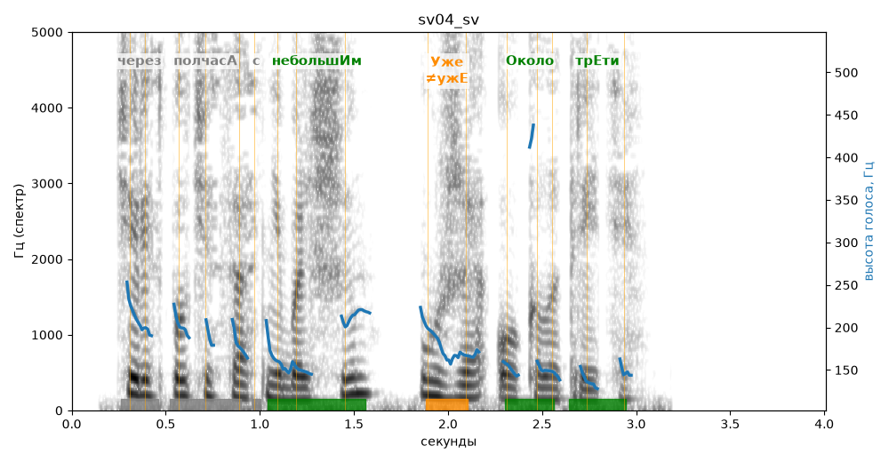

# sv04_sv

Голос: **edge:ru-RU-SvetlanaNeural** · длительность 4.0 с
Естественность (UTMOS): **3.72 из 5** (живой диктор ≈ 4–4.5)
Эталон: Через полчаса с небольшим — уже около трети.
Распознано: Через полчаса с небольшим уже около трети.
Слова: все совпали

## Ударения
(где нужно: ruaccent)

| слово | нужно | у голоса | |
|---|---|---|---|
| через | через | чЕрез | нет эталона |
| полчаса | полчасА | пОлчаса | ? не разобрать |
| небольшим | небольшИм | небольшИм | ✓ |
| уже | Уже | ужЕ | ✗? возможно — послушать |
| около | Около | Около | ✓ |
| трети | трЕти | трЕти | ✓ |

## Интонация
- ✓ «через полчаса с небольшим уже около трети.» — конец фразы понижается — звучит законченно
- Диапазон голоса 8.0 полутонов (живо), средняя высота 168 Гц

## Паузы и темп
- паузы на своих местах
- Темп 7.4 слога/с (быстро)

_Синяя линия — высота голоса. Над словами заглавная буква — где ударение должно быть; красным — голос поставил не туда (уверенно), оранжевым — возможно._
