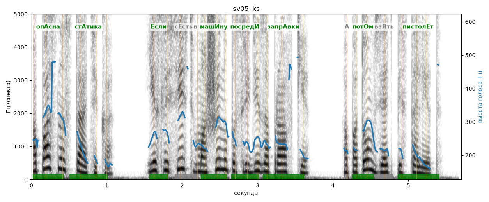

# sv05_ks

Голос: **silero:kseniya** · длительность 5.7 с
Естественность (UTMOS): **4.02 из 5** (живой диктор ≈ 4–4.5)
Эталон: Опасна статика: если сесть в машину посреди заправки, а потом взять пистолет.
Распознано: Опасно статика, если сесть в машину посреди заправки, а потом взять пистолет.
Расхождения в словах: «опасна» → «опасно»

## Ударения
(где нужно: ruaccent)

| слово | нужно | у голоса | |
|---|---|---|---|
| опасна | опАсна | опАсна | ✓ |
| статика | стАтика | стАтика | ✓ |
| если | Если | Если | ✓ |
| машину | машИну | машИну | ✓ |
| посреди | посредИ | посредИ | ✓ |
| заправки | запрАвки | запрАвки | ✓ |
| потом | потОм | потОм | ✓ |
| пистолет | пистолЕт | пистолЕт | ✓ |

## Интонация
- ✓ «опасна статика если сесть в машину посреди заправки а потом взять пистолет.» — конец фразы понижается — звучит законченно
- Диапазон голоса 16.2 полутонов (живо), средняя высота 235 Гц

## Паузы и темп
- паузы на своих местах
- Темп 6.1 слога/с (нормально)

_Синяя линия — высота голоса. Над словами заглавная буква — где ударение должно быть; красным — голос поставил не туда (уверенно), оранжевым — возможно._
