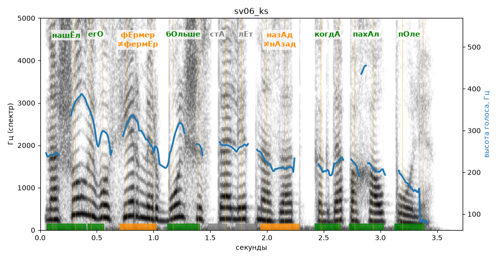

# sv06_ks

Голос: **silero:kseniya** · длительность 3.7 с
Естественность (UTMOS): **3.61 из 5** (живой диктор ≈ 4–4.5)
Эталон: Нашёл его фермер больше ста лет назад, когда пахал поле.
Распознано: Нашёл его фермер больше 100 лет назад, когда пахал поле.
Расхождения в словах: «ста» → «100»

## Ударения
(где нужно: ruaccent)

| слово | нужно | у голоса | |
|---|---|---|---|
| нашёл | нашЁл | нашЁл | ✓ |
| его | егО | егО | ✓ |
| фермер | фЕрмер | фермЕр | ✗? возможно — послушать |
| больше | бОльше | бОльше | ✓ |
| назад | назАд | нАзад | ✗? возможно — послушать |
| когда | когдА | когдА | ✓ |
| пахал | пахАл | пахАл | ✓ |
| поле | пОле | пОле | ✓ |

## Интонация
- ✓ «нашёл его фермер больше ста лет назад когда пахал поле.» — конец фразы понижается — звучит законченно
- Диапазон голоса 14.7 полутонов (живо), средняя высота 245 Гц

## Паузы и темп
- паузы на своих местах
- Темп 5.4 слога/с (нормально)

_Синяя линия — высота голоса. Над словами заглавная буква — где ударение должно быть; красным — голос поставил не туда (уверенно), оранжевым — возможно._
