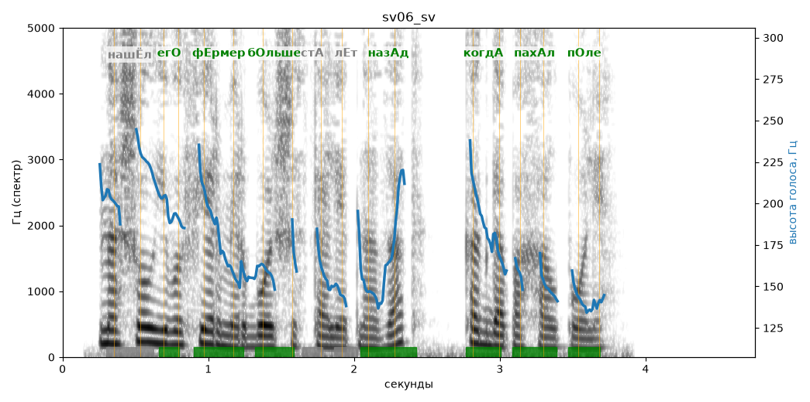

# sv06_sv

Голос: **edge:ru-RU-SvetlanaNeural** · длительность 4.8 с
Естественность (UTMOS): **3.86 из 5** (живой диктор ≈ 4–4.5)
Эталон: Нашёл его фермер больше ста лет назад, когда пахал поле.
Распознано: Нашел его фермер больше ста лет назад, когда пахал поле.
Слова: все совпали

## Ударения
(где нужно: ruaccent)

| слово | нужно | у голоса | |
|---|---|---|---|
| нашёл | нашЁл | нАшёл | ? не разобрать |
| его | егО | егО | ✓ |
| фермер | фЕрмер | фЕрмер | ✓ |
| больше | бОльше | бОльше | ✓ |
| назад | назАд | назАд | ✓ |
| когда | когдА | когдА | ✓ |
| пахал | пахАл | пахАл | ✓ |
| поле | пОле | пОле | ✓ |

## Интонация
- ✓ «нашёл его фермер больше ста лет назад когда пахал поле.» — конец фразы понижается — звучит законченно
- Диапазон голоса 8.2 полутонов (живо), средняя высота 164 Гц

## Паузы и темп
- паузы на своих местах
- Темп 5.9 слога/с (нормально)

_Синяя линия — высота голоса. Над словами заглавная буква — где ударение должно быть; красным — голос поставил не туда (уверенно), оранжевым — возможно._
