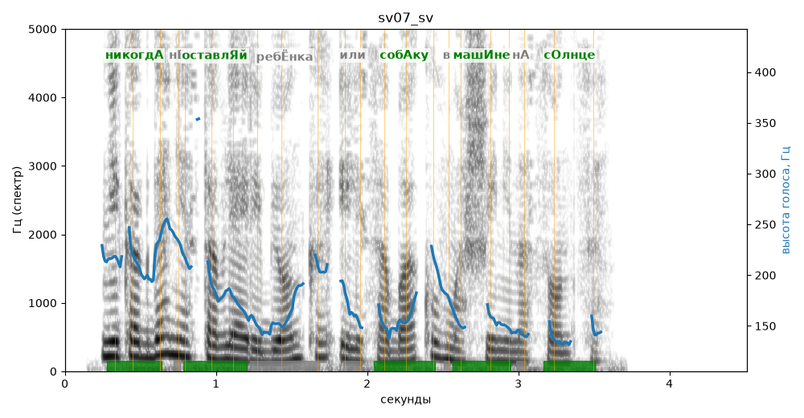

# sv07_sv

Голос: **edge:ru-RU-SvetlanaNeural** · длительность 4.5 с
Естественность (UTMOS): **3.87 из 5** (живой диктор ≈ 4–4.5)
Эталон: Никогда не оставляй ребёнка или собаку в машине на солнце.
Распознано: никогда не оставляй ребенка или собаку в машине на солнце
Слова: все совпали

## Ударения
(где нужно: ruaccent)

| слово | нужно | у голоса | |
|---|---|---|---|
| никогда | никогдА | никогдА | ✓ |
| оставляй | оставлЯй | оставлЯй | ✓ |
| ребёнка | ребЁнка | ребёнкА | ? не разобрать |
| или | или | Или | нет эталона |
| собаку | собАку | собАку | ✓ |
| машине | машИне | машИне | ✓ |
| солнце | сОлнце | сОлнце | ✓ |

## Интонация
- ✓ «никогда не оставляй ребёнка или собаку в машине на солнце.» — конец фразы понижается — звучит законченно
- Диапазон голоса 9.4 полутонов (живо), средняя высота 167 Гц

## Паузы и темп
- паузы на своих местах
- Темп 7.2 слога/с (быстро)

_Синяя линия — высота голоса. Над словами заглавная буква — где ударение должно быть; красным — голос поставил не туда (уверенно), оранжевым — возможно._
