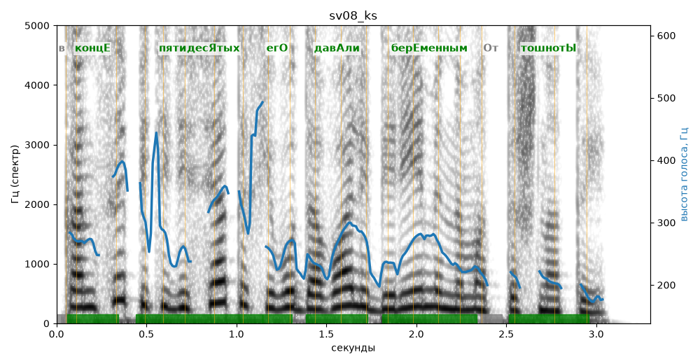

# sv08_ks

Голос: **silero:kseniya** · длительность 3.3 с
Естественность (UTMOS): **3.81 из 5** (живой диктор ≈ 4–4.5)
Эталон: В конце пятидесятых его давали беременным от тошноты.
Распознано: К конце 50-х его давали беременным оттошноты.
Расхождения в словах: «в» → «к»; «пятидесятых» → «50-х»; «от тошноты» → «оттошноты»

## Ударения
(где нужно: ruaccent)

| слово | нужно | у голоса | |
|---|---|---|---|
| конце | концЕ | концЕ | ✓ |
| пятидесятых | пятидесЯтых | пятидесЯтых | ✓ |
| его | егО | егО | ✓ |
| давали | давАли | давАли | ✓ |
| беременным | берЕменным | берЕменным | ✓ |
| тошноты | тошнотЫ | тошнотЫ | ✓ |

## Интонация
- ✓ «в конце пятидесятых его давали беременным от тошноты.» — конец фразы понижается — звучит законченно
- Диапазон голоса 12.2 полутонов (живо), средняя высота 253 Гц

## Паузы и темп
- паузы на своих местах
- Темп 7.1 слога/с (быстро)

_Синяя линия — высота голоса. Над словами заглавная буква — где ударение должно быть; красным — голос поставил не туда (уверенно), оранжевым — возможно._
