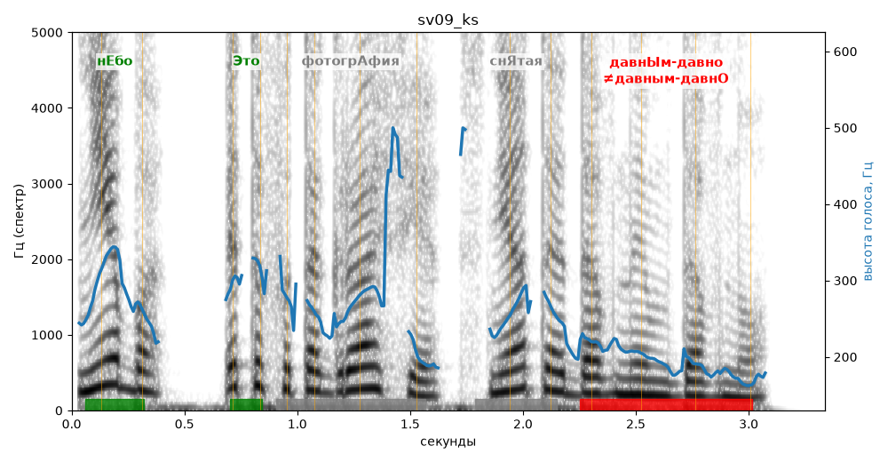

# sv09_ks

Голос: **silero:kseniya** · длительность 3.3 с
Естественность (UTMOS): **3.81 из 5** (живой диктор ≈ 4–4.5)
Эталон: Небо — это фотография, снятая давным-давно.
Распознано: Небо – это фотография, снятая давным-давно.
Слова: все совпали

## Ударения
(где нужно: ruaccent)

| слово | нужно | у голоса | |
|---|---|---|---|
| небо | нЕбо | нЕбо | ✓ |
| это | Это | Это | ✓ |
| фотография | фотогрАфия | — | ? |
| снятая | снЯтая | — | ? |
| давным-давно | давнЫм-давно | давным-давнО | ✗ ОШИБКА |

## Интонация
- ✓ «небо это фотография снятая давным-давно.» — конец фразы понижается — звучит законченно
- Диапазон голоса 12.3 полутонов (живо), средняя высота 240 Гц

## Паузы и темп
- паузы на своих местах
- Темп 6.0 слога/с (нормально)

_Синяя линия — высота голоса. Над словами заглавная буква — где ударение должно быть; красным — голос поставил не туда (уверенно), оранжевым — возможно._
