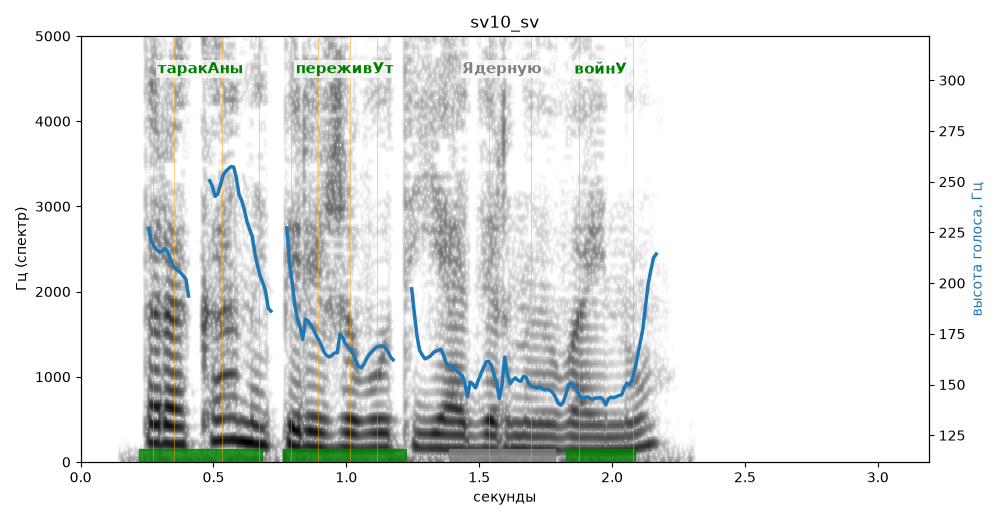

# sv10_sv

Голос: **edge:ru-RU-SvetlanaNeural** · длительность 3.2 с
Естественность (UTMOS): **3.75 из 5** (живой диктор ≈ 4–4.5)
Эталон: Тараканы переживут ядерную войну?
Распознано: Тараканы переживут ядерную войну?
Слова: все совпали

## Ударения
(где нужно: ruaccent)

| слово | нужно | у голоса | |
|---|---|---|---|
| тараканы | таракАны | таракАны | ✓ |
| переживут | переживУт | переживУт | ✓ |
| ядерную | Ядерную | — | ? |
| войну | войнУ | войнУ | ✓ |

## Интонация
- ✗ «тараканы переживут ядерную войну?» — нет вопросительного подъёма (самое высокое место — «тараканы», в начале) — звучит как утверждение
- Диапазон голоса 9.3 полутонов (живо), средняя высота 164 Гц

## Паузы и темп
- паузы на своих местах
- Темп 7.0 слога/с (быстро)

_Синяя линия — высота голоса. Над словами заглавная буква — где ударение должно быть; красным — голос поставил не туда (уверенно), оранжевым — возможно._
