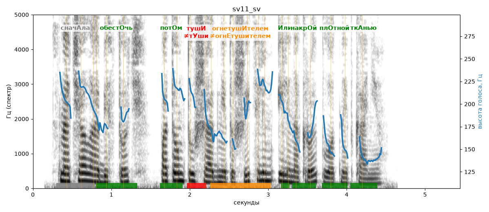

# sv11_sv

Голос: **edge:ru-RU-SvetlanaNeural** · длительность 5.4 с
Естественность (UTMOS): **3.75 из 5** (живой диктор ≈ 4–4.5)
Эталон: Сначала обесточь, потом туши огнетушителем или накрой плотной тканью.
Распознано: Сначала обесточь, потом туши огнетушителем или накрой плотной тканью.
Слова: все совпали

## Ударения
(где нужно: ruaccent)

| слово | нужно | у голоса | |
|---|---|---|---|
| сначала | сначАла | сначалА | ? не разобрать |
| обесточь | обестОчь | обестОчь | ✓ |
| потом | потОм | потОм | ✓ |
| туши | тушИ | тУши | ✗ ОШИБКА |
| огнетушителем | огнетушИтелем | огнЕтушителем | ✗? возможно — послушать |
| или | Или | Или | ✓ |
| накрой | накрОй | накрОй | ✓ |
| плотной | плОтной | плОтной | ✓ |
| тканью | ткАнью | ткАнью | ✓ |

## Интонация
- ✓ «сначала обесточь потом туши огнетушителем или накрой плотной тканью.» — конец фразы понижается — звучит законченно
- Диапазон голоса 8.4 полутонов (живо), средняя высота 184 Гц

## Паузы и темп
- паузы на своих местах
- Темп 6.1 слога/с (нормально)

_Синяя линия — высота голоса. Над словами заглавная буква — где ударение должно быть; красным — голос поставил не туда (уверенно), оранжевым — возможно._
