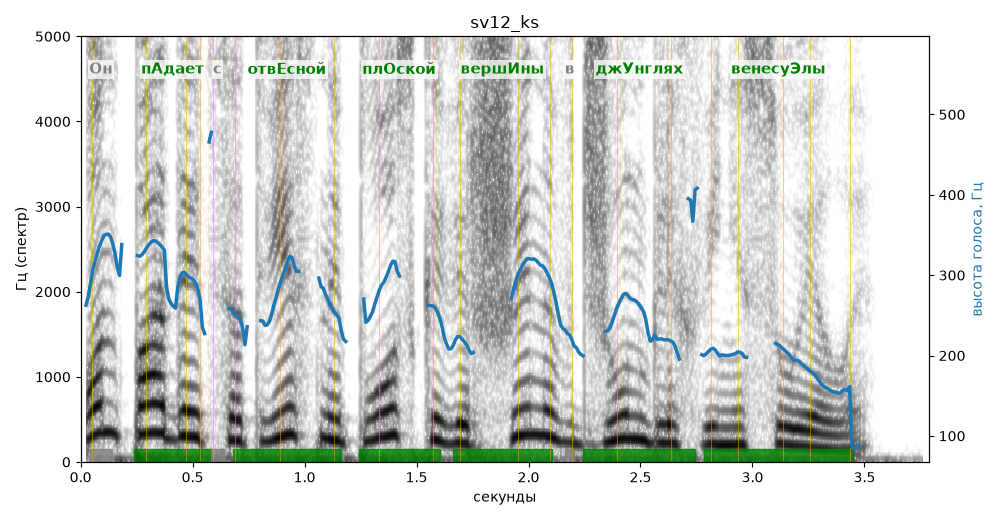

# sv12_ks

Голос: **silero:kseniya** · длительность 3.8 с
Естественность (UTMOS): **3.64 из 5** (живой диктор ≈ 4–4.5)
Эталон: Он падает с отвесной плоской вершины в джунглях Венесуэлы.
Распознано: Он падает с ответственной плоской вершины в джунглях Венесуэлы.
Расхождения в словах: «отвесной» → «ответственной»

## Ударения
(где нужно: ruaccent)

| слово | нужно | у голоса | |
|---|---|---|---|
| падает | пАдает | пАдает | ✓ |
| отвесной | отвЕсной | отвЕсной | ✓ |
| плоской | плОской | плОской | ✓ |
| вершины | вершИны | вершИны | ✓ |
| джунглях | джУнглях | джУнглях | ✓ |
| венесуэлы | венесуЭлы | венесуЭлы | ✓ |

## Интонация
- ✓ «он падает с отвесной плоской вершины в джунглях венесуэлы.» — конец фразы понижается — звучит законченно
- Диапазон голоса 13.3 полутонов (живо), средняя высота 253 Гц

## Паузы и темп
- паузы на своих местах
- Темп 6.2 слога/с (нормально)

_Синяя линия — высота голоса. Над словами заглавная буква — где ударение должно быть; красным — голос поставил не туда (уверенно), оранжевым — возможно._
