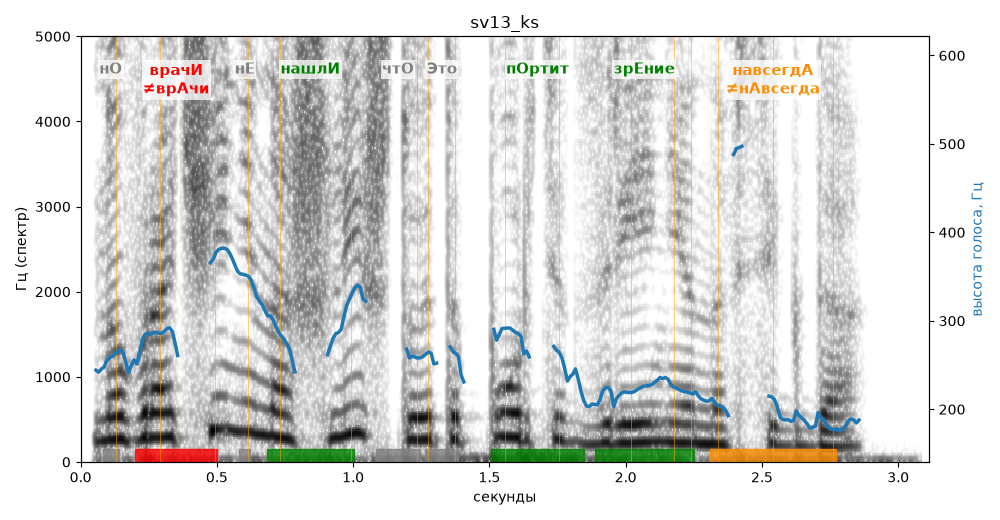

# sv13_ks

Голос: **silero:kseniya** · длительность 3.1 с
Естественность (UTMOS): **3.62 из 5** (живой диктор ≈ 4–4.5)
Эталон: Но врачи не нашли, что это портит зрение навсегда.
Распознано: Но врачи не нашли, что это портит зрение навсегда.
Слова: все совпали

## Ударения
(где нужно: ruaccent)

| слово | нужно | у голоса | |
|---|---|---|---|
| врачи | врачИ | врАчи | ✗ ОШИБКА |
| нашли | нашлИ | нашлИ | ✓ |
| это | Это | этО | ? не разобрать |
| портит | пОртит | пОртит | ✓ |
| зрение | зрЕние | зрЕние | ✓ |
| навсегда | навсегдА | нАвсегда | ✗? возможно — послушать |

## Интонация
- ✓ «но врачи не нашли что это портит зрение навсегда.» — конец фразы понижается — звучит законченно
- Диапазон голоса 12.2 полутонов (живо), средняя высота 252 Гц

## Паузы и темп
- паузы на своих местах
- Темп 6.3 слога/с (нормально)

_Синяя линия — высота голоса. Над словами заглавная буква — где ударение должно быть; красным — голос поставил не туда (уверенно), оранжевым — возможно._
