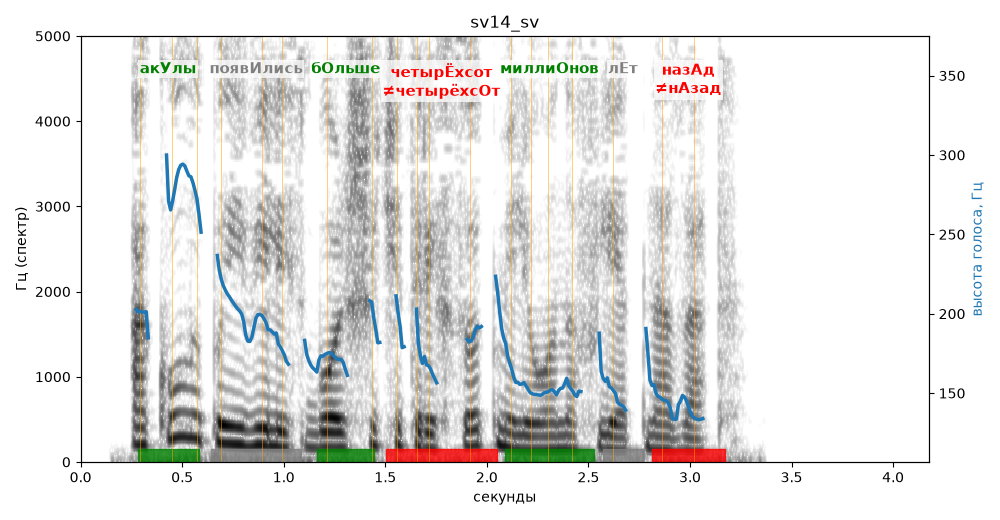

# sv14_sv

Голос: **edge:ru-RU-SvetlanaNeural** · длительность 4.2 с
Естественность (UTMOS): **3.85 из 5** (живой диктор ≈ 4–4.5)
Эталон: Акулы появились больше четырёхсот миллионов лет назад.
Распознано: Акулы появились больше 400 миллионов лет назад.
Расхождения в словах: «четырехсот» → «400»

## Ударения
(где нужно: ruaccent)

| слово | нужно | у голоса | |
|---|---|---|---|
| акулы | акУлы | акУлы | ✓ |
| появились | появИлись | — | ? |
| больше | бОльше | бОльше | ✓ |
| четырёхсот | четырЁхсот | четырёхсОт | ✗ ОШИБКА |
| миллионов | миллиОнов | миллиОнов | ✓ |
| назад | назАд | нАзад | ✗ ОШИБКА |

## Интонация
- ✓ «акулы появились больше четырёхсот миллионов лет назад.» — конец фразы понижается — звучит законченно
- Диапазон голоса 12.0 полутонов (живо), средняя высота 173 Гц

## Паузы и темп
- паузы на своих местах
- Темп 6.6 слога/с (быстро)

_Синяя линия — высота голоса. Над словами заглавная буква — где ударение должно быть; красным — голос поставил не туда (уверенно), оранжевым — возможно._
