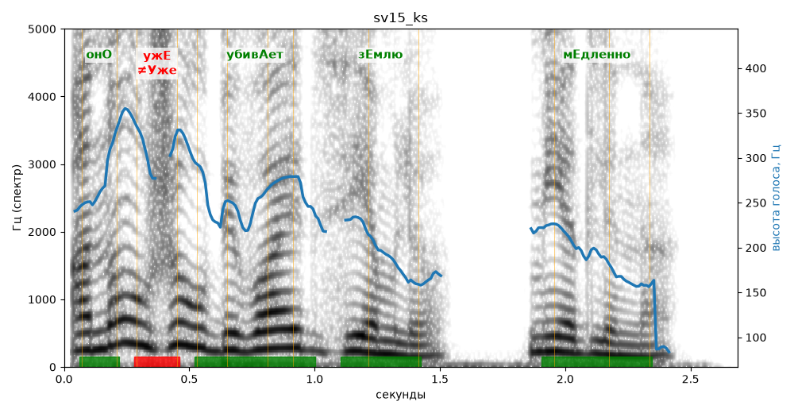

# sv15_ks

Голос: **silero:kseniya** · длительность 2.7 с
Естественность (UTMOS): **3.57 из 5** (живой диктор ≈ 4–4.5)
Эталон: Оно уже убивает Землю — медленно.
Распознано: Она уже убивает землю. Медленно.
Расхождения в словах: «оно» → «она»

## Ударения
(где нужно: ruaccent)

| слово | нужно | у голоса | |
|---|---|---|---|
| оно | онО | онО | ✓ |
| уже | ужЕ | Уже | ✗ ОШИБКА |
| убивает | убивАет | убивАет | ✓ |
| землю | зЕмлю | зЕмлю | ✓ |
| медленно | мЕдленно | мЕдленно | ✓ |

## Интонация
- ✓ «оно уже убивает землю медленно.» — конец фразы понижается — звучит законченно
- Диапазон голоса 12.8 полутонов (живо), средняя высота 227 Гц

## Паузы и темп
- паузы на своих местах
- Темп 7.2 слога/с (быстро)

_Синяя линия — высота голоса. Над словами заглавная буква — где ударение должно быть; красным — голос поставил не туда (уверенно), оранжевым — возможно._
