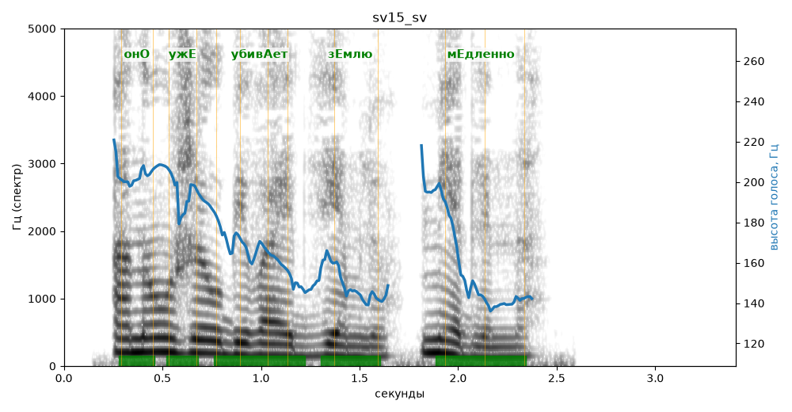

# sv15_sv

Голос: **edge:ru-RU-SvetlanaNeural** · длительность 3.4 с
Естественность (UTMOS): **3.57 из 5** (живой диктор ≈ 4–4.5)
Эталон: Оно уже убивает Землю — медленно.
Распознано: Она уже убивает землю, медленно.
Расхождения в словах: «оно» → «она»

## Ударения
(где нужно: ruaccent)

| слово | нужно | у голоса | |
|---|---|---|---|
| оно | онО | онО | ✓ |
| уже | ужЕ | ужЕ | ✓ |
| убивает | убивАет | убивАет | ✓ |
| землю | зЕмлю | зЕмлю | ✓ |
| медленно | мЕдленно | мЕдленно | ✓ |

## Интонация
- ✗ «оно уже убивает землю медленно.» — конец фразы не понижается — звучит незаконченно / как перечисление
- Диапазон голоса 6.9 полутонов (нормально), средняя высота 164 Гц

## Паузы и темп
- паузы на своих местах
- Темп 7.3 слога/с (быстро)

_Синяя линия — высота голоса. Над словами заглавная буква — где ударение должно быть; красным — голос поставил не туда (уверенно), оранжевым — возможно._
